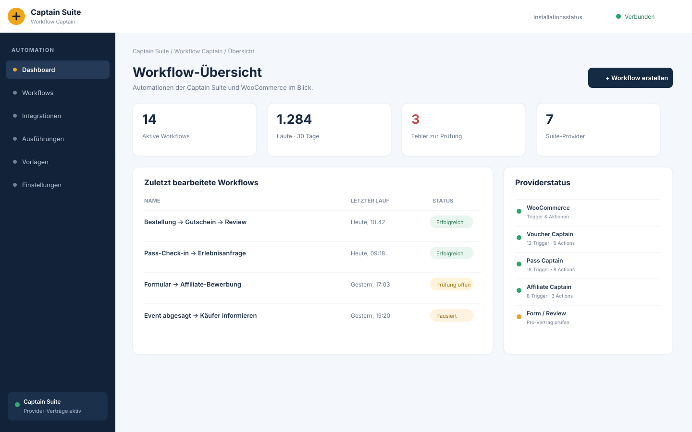
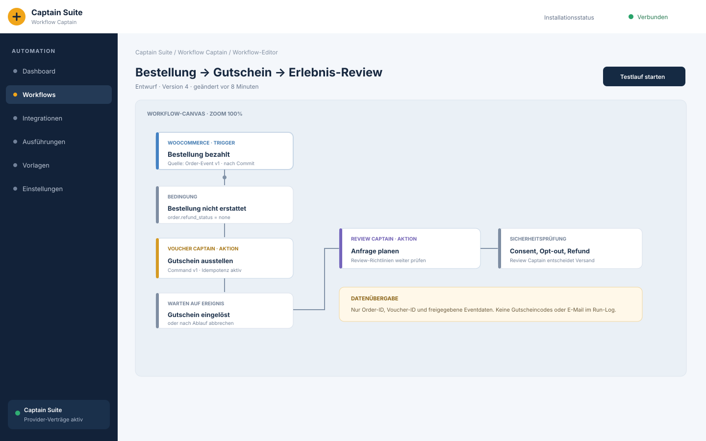
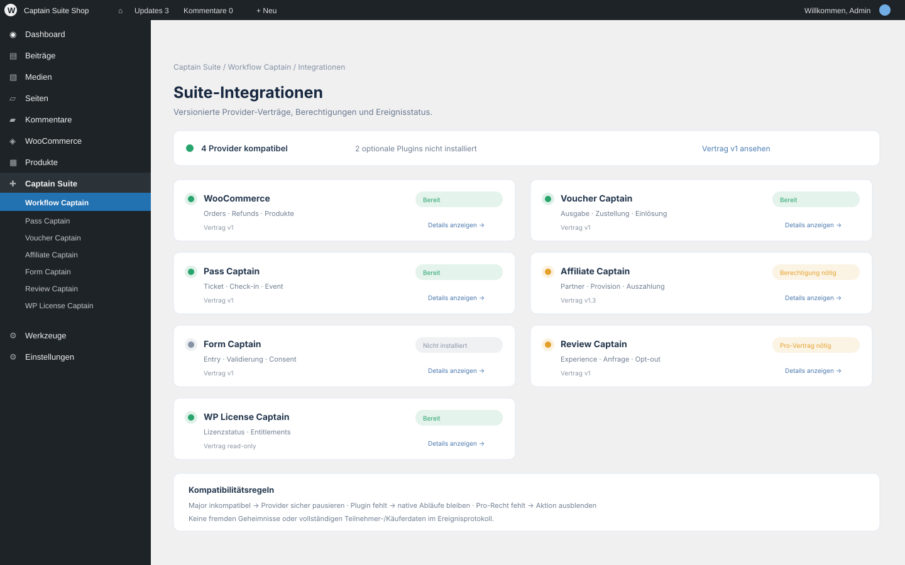
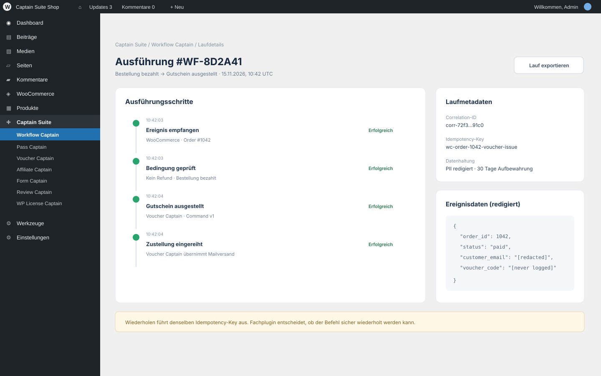
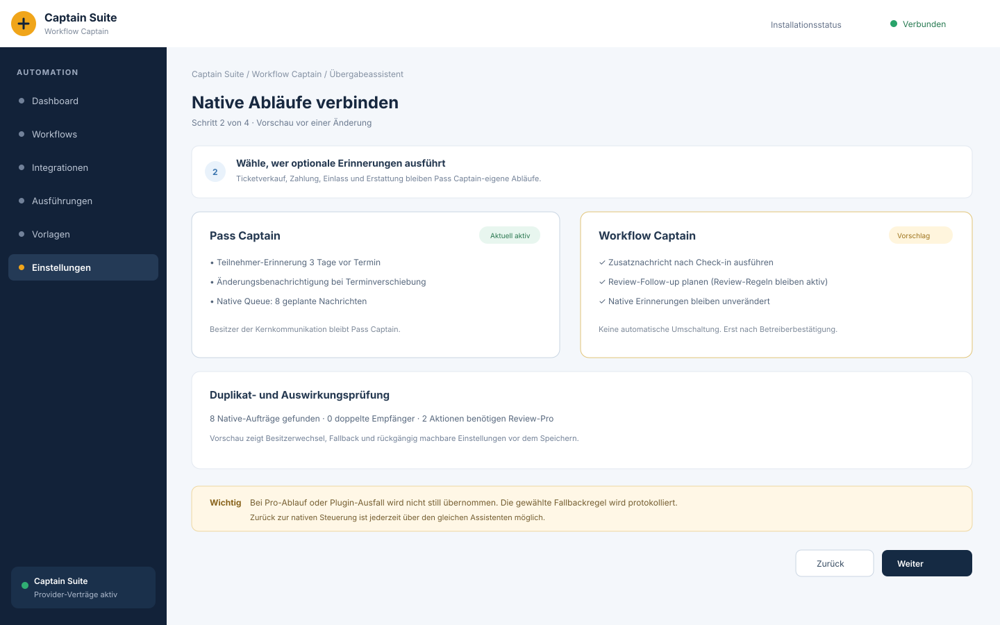
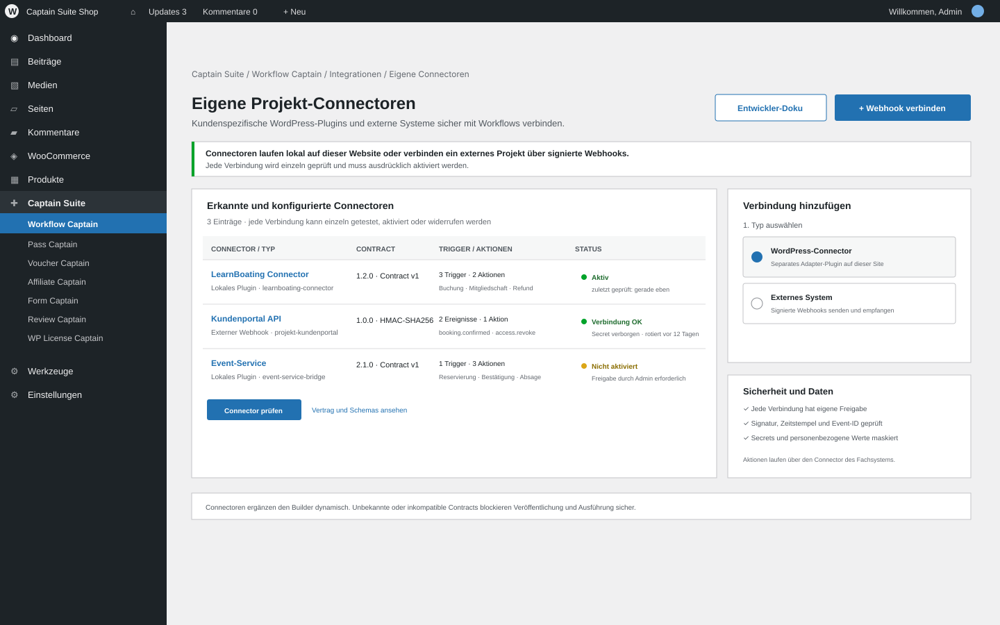
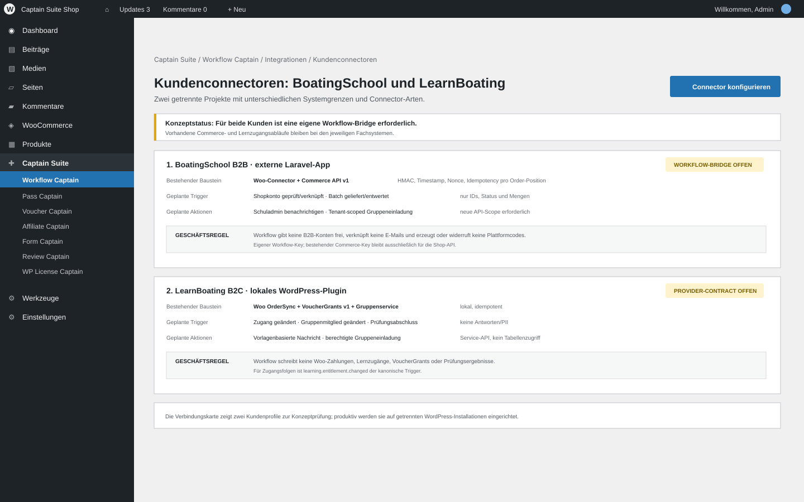
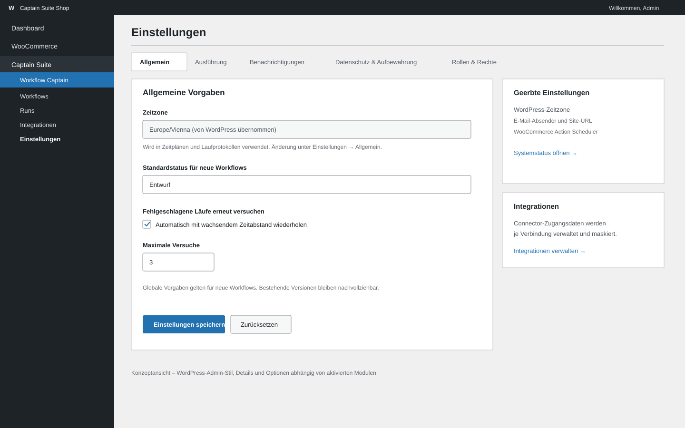
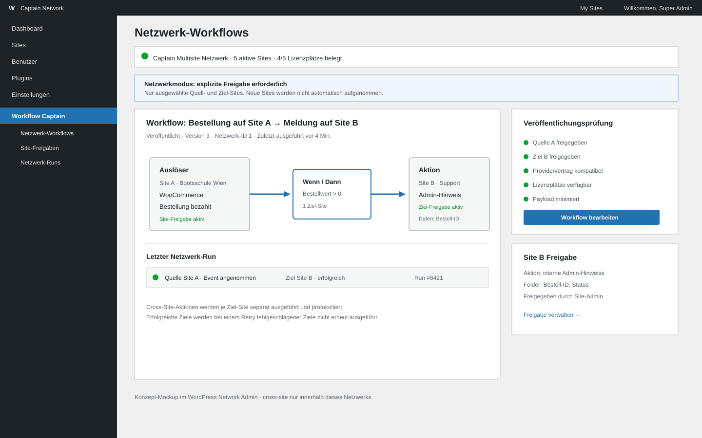

# Workflow Captain – Produktkonzept

**Status:** Konzept zur Produktentscheidung und Umsetzung  
**Stand:** 15. November 2026  
**Produktname:** Workflow Captain  
**Repository:** `hastla007/wp-workflowmaster`  
**Kern-Plugin (kostenlos):** `workflow-captain`  
**Premium-Add-on:** `workflow-captain-pro`  
**Lizenzserver-Produktschlüssel:** `workflow-captain-pro` (im Katalog von WP License Captain anzulegen)  
**Rechte-Präfix:** `workflow.`  
**Kern-Plugin-Slug/Textdomain:** `workflow-captain`  
**Vorgesehener Pro-Ort:** `hastla007/captain-pro/addons/workflow-captain-pro/`

> **Maßgeblich seit 16.11.2026:** `docs/SPEC-suite-events.md` ist die normative Spezifikation für die Zusammenarbeit der Suite-Plugins (Entscheidung D1) und geht jeder abweichenden Stelle dieses Konzepts vor. Überholte Stellen sind unten mit „Überholt“ und der Nummer der Entscheidung gekennzeichnet, nicht gelöscht. Offene Punkte: `docs/SPEC-open-questions.md`.

> Dieses Dokument ist die Produkt- und Umsetzungsgrundlage. Es beschreibt geplante Verträge und Funktionen, keine bereits vorhandenen Hooks, API-Rechte oder getestete Kompatibilität. Vor Releases sind Plattform-, Datenschutz-, Sicherheits- und Lizenzbedingungen erneut zu prüfen.

> **Stand der Umsetzung (16.11.2026):** Abweichend von D12 wird seit dem 16.11.2026 gebaut. Plugin `workflow-captain` 0.2.x enthält den Consumer nach `docs/SPEC-suite-events.md` und die Workflow-Engine: Workflows mit unveränderlichen Versionen, Bedingungen, Wartezeiten, Läufe und Schritte mit sicherer Wiederholung, die Aktionen der Version 1 (Nachrichten, Markierungen, Notizen), einen visuellen Builder (erste Fassung), Testlauf, Datenschutz, Einstellungen, Diagnose, WP-CLI und Website-Zustand. Seit den Entscheidungen F-07, F-20 und F-22 außerdem: Auslöser aus WordPress und WooCommerce im kostenlosen Kern, eigene Connectoren mit Manifest und Freigabe, wiederkehrende Zeitpläne, Vertragsversion je Provider im Lauf, Bausteine für ausgehende und eingehende Anfragen (`SafeHttp`, `InboundGuard`). In Arbeit in `captain-pro` (Branch `claude/plugin-todo-liste-2a83v4`): Add-on `workflow-captain-pro` mit den Suite-Adaptern; danach Webhooks, n8n und netzwerkweite Abläufe. Gutschein-Befehle warten auf VC-1. Wo der Code eine Festlegung dieses Konzepts anders löst, steht es unten mit „Umsetzung“ vermerkt. Tests und offene Fälle: `docs/TESTMATRIX.md`.
## Lizenzmodell und Produktabgrenzung

WP License Captain (License Captain Server) ist ein eigenständiges, separat verkauftes Server-Plugin und kein Bestandteil von Workflow Captain Pro. Workflow Captain Pro enthält nur die Client-Komponente, die wir zur Prüfung der eigenen PRO-Lizenzen an unserem Lizenzserver verwenden. Diese interne Lizenzierungsinfrastruktur hat für den Kunden keinen eigenständigen Produktnutzen und wird vor dem Kauf nicht als PRO-Leistung kommuniziert. Käufer benötigen keinen eigenen License Captain Server, um Workflow Captain Pro zu nutzen.

## 1. Produktidee und Ziel

Workflow Captain ist der zentrale, visuelle Automatisierungsbaukasten der Captain Suite. Betreiber verbinden Ereignisse aus WordPress, WooCommerce und installierten Captain-Plugins mit Bedingungen, Verzögerungen und Aktionen. Damit sollen wiederkehrende Abläufe ohne individuellen Code abgebildet werden, zum Beispiel:

- Wenn eine WooCommerce-Bestellung bezahlt ist, einen Gutschein versenden und nach Ablauf der Liefer-/Einlassfrist eine Review-Anfrage einplanen.
- Wenn ein Pass-Ticket ausgegeben wird, eine Bestellbestätigung ergänzen; bei Veranstaltungsabsage Käufer benachrichtigen.
- Wenn ein Formular mit einem bestimmten Anliegen eingereicht wird, den Administrator informieren und einen Follow-up-Schritt terminieren.
- Wenn eine Partnerbewerbung eingeht, eine interne Aufgabe/Benachrichtigung starten; Freigabe und Provisionslogik bleiben bei Affiliate Captain.
- Wenn ein Coupon eingelöst oder ein Guthaben-Schwellwert erreicht wird, eine freigegebene Nachricht oder einen weiteren Suite-Ablauf auslösen.

**Versprechen:** „Ein Ereignis in der Suite löst den nächsten passenden Schritt aus – nachvollziehbar, sicher und ohne Datenkopien zwischen Plugins.“

Workflow Captain ist eine Orchestrierungsschicht. Jedes Fach-Plugin bleibt Eigentümer seiner Daten und Geschäftsregeln. Der Workflow liest nur die vom jeweiligen Provider freigegebenen Ereignisdaten und führt Aktionen ausschließlich über öffentliche APIs/Service-Verträge des Ziel-Plugins aus. Direkte Tabellenzugriffe, unsichere SQL-Updates und doppelte Fachlogik sind ausgeschlossen.

## 2. Zielgruppen und Probleme

### Zielgruppen

1. WooCommerce-Shops, die Bestellungen, Gutscheine, Tickets und Kundenkommunikation verbinden wollen.
2. Veranstalter mit Pass Captain und WooCommerce, die Ticket-, Storno- und Eventabläufe automatisieren.
3. Gutscheinanbieter, die Ausstellung, Zustellung, Einlösung und Feedback zusammenführen möchten.
4. Captain-Suite-Betreiber, die Suite-Plugins miteinander kombinieren und weniger manuelle Adminarbeit wollen.
5. Agenturen und technische Betreiber, die wiederholbare Abläufe dokumentieren und überwachen müssen.

### Kernprobleme, die das Produkt lösen soll

- Suite-Plugins erzeugen wichtige Ereignisse, bieten aber heute nicht zwingend überall einen gemeinsamen Workflow-Builder.
- WooCommerce-Status, Teilnehmer-/Ticketstatus, Gutscheinstatus, Formulareinsendungen und Affiliate-Zustände haben unterschiedliche Datenmodelle.
- Zeitversetzte Abläufe und Wiederholungsversuche dürfen nicht in ad-hoc-Cronjobs je Integration enden.
- Betreiber brauchen nachvollziehbare Ausführungsprotokolle, sichere Wiederholungen und eine Möglichkeit, Fehler gezielt zu reparieren.
- Fremdautomationsdienste benötigen API-Schlüssel und externe Konten. Workflow Captain soll grundlegende lokale Abläufe direkt in WordPress ausführen und externe Übergaben später kontrolliert ergänzen.

## 3. Anonymisierte Marktanforderungen und Produktpositionierung

Die Marktbeobachtung wird ausschließlich funktionsbezogen dokumentiert, ohne fremde Automationsprodukte, Marken oder Anbieter-URLs. Anforderungen: visuelle Trigger/Aktionsketten, Bedingungen/Tokens, lokale Ausführung, zeitgesteuerte Aktionen, sichere Webhooks, optionale App-Adapter, Fehlerdiagnose und idempotente Wiederholung. Workflow Captain priorisiert stabile Suite-Provider, WordPress-Datensouveränität und einen produktiven Free-Kern.

### Differenzierung

Workflow Captain soll nicht mit der größten Zahl von Integrationen starten. Die Differenzierung ist:

- **Suite-Tiefe:** Ereignisse und Aktionen der Captain Plugins sind konkrete Fachfunktionen statt generischer Meta-Feld-Schreibzugriffe.
- **Saubere Fachgrenzen:** Pass Captain verwaltet Tickets und Einlass; Voucher Captain verwaltet Gutscheine; Affiliate Captain verwaltet Partner und Provisionen; Review Captain verwaltet Bewertungen und Einladungen; Form Captain verwaltet Formulare und Einsendungen.
- **Idempotente Ausführung:** doppelte WooCommerce- oder Plugin-Hooks dürfen keine doppelten Gutscheine, Partnerbuchungen oder E-Mails erzeugen.
- **Betriebstransparenz:** jeder Lauf hat Status, Ursache, Zeit, betroffene Aktion und sichere Wiederholungsoption.
- **Lokal ausführbar:** Workflows, Warteschlange und Protokolle liegen auf der WordPress-Website; externe Konten sind nur für explizite Fremddienste nötig.
- **Free ist produktiv nutzbar:** Free bietet native WP-Ereignisse/-Aktionen und einfache lineare Abläufe. Pro monetarisiert erweiterte Logik, Suite-Adapter und Betriebskomfort.

## 4. Produktaufteilung: Free und Pro

### Workflow Captain (Free, eigenständiger Kern)

Free soll im Wettbewerb sofort benutzbar sein. Es enthält keine Lizenzprüfung und keine Nutzungs- oder Task-Credit-Grenzen.

- Unbegrenzte Workflows und Ausführungen auf einer WordPress-Website; kein externer Account erforderlich.
- Visueller Editor mit mehreren Auslösern, mehreren Aktionen, geordneter Schrittfolge, einfachen Bedingungen, Verzögerung und Datum/Zeitplanung.
- WordPress-Core- und WooCommerce-Provider für die gängigen Inhalts-, Benutzer-, Bestell-, Refund-, Produkt- und Coupon-Ereignisse.
- Einfacher AND/OR-Filter auf Ereignisfeldern, dynamische Tokens und sichere E-Mail-/Adminaktionen.
- WooCommerce-Aktionen: Bestellnotiz, zulässige Statusänderung, Kunden-/Adminbenachrichtigung und CRUD-Meta.
- Einfaches Ausführungsprotokoll für 30 Tage, Test-/Dry-Run, pausieren/aktivieren, duplizieren und Fehlerstatus.
- Entwickler-Registry für Drittanbieterprovider mit dokumentiertem Contract.
- Queue-Schutz gegen Lastspitzen; Systemlimits dürfen verzögern oder verständlich ablehnen, erzeugen aber niemals Task-Kosten.

Free umfasst keine Captain-Suite-Provider oder externen Serviceverbindungen. Premiumintegrationen sind ein legitimer Add-on-Mehrwert. Das kostenlose Kernplugin bleibt eigenständig und ohne Lizenzclient.

### Workflow Captain Pro (separates Add-on, lizenziert)

- Alle sechs Captain-Provider: WP License Captain, WooCommerce (erweiterte Suite-Aktionen), Pass, Voucher, Affiliate, Form und Review Captain. *[Überholt durch D2: Lizenzereignisse gibt es nur im Shop des Herstellers, nicht bei Käufern; siehe `docs/SPEC-suite-events.md`, Abschnitt 11.]*
- Sichere, signierte Ein-/Ausgangswebhooks als Brücke zu Fremdsystemen und anderen WordPress-Websites. V1 enthält keine native App-Bibliothek für Hunderte Drittanbieter.
- Erweiterte Event-Korrelation, If/Else-Verzweigung, Bedingungsgruppen und Freigabeschritte.
- Geplante Queue-Aktionen mit Geschäftslogik zur Stornierung bei Refund/Storno oder Statusänderung.
- Idempotente Aktionen, begrenzte Retry-Strategie, kontrolliertes Replay, Audit-Historie und vollständige Einzelschritt-Protokolle.
- Suite-Rezeptvorlagen, Versionierung sowie schema-geprüfter Export/Import.
- Erweitertes Rollen-/Capability-Modell, Protokollexport und bis zu 365 Tage einstellbare Pro-Aufbewahrung.
- Alle Pro-Funktionen in jedem Lizenzplan; Tarife unterscheiden sich ausschließlich über Live-Sites und Support.

Externe App-Plattformen und Cloud-Runs sind nicht Teil von Version 1; Webhooks sind der ausdrücklich begrenzte Interoperabilitätsweg.

### Lizenzvertrag

- Produktschlüssel/Add-on-Ordner/Textdomain: `workflow-captain-pro`; Rechtepräfix: `workflow.`.
- Pro nutzt den bestehenden WP-License-Client und Add-on-Kernel in `captain-pro`. Free enthält keinerlei Lizenzcode.
- Die Pläne verwenden nur `sites.live_limit` und `support.level` als Tarifunterschiede; es gibt keine pro-Feature-Tiers, Run-Limits oder Task-Credits.
- Premiumrechte: `workflow.suite_integrations`, `workflow.custom_connectors`, `workflow.webhooks`, `workflow.event_correlation`, `workflow.advanced_logic`, `workflow.delays`, `workflow.multisite_network`, `workflow.recipe_templates`, `workflow.extended_logs`. *[Hinweis: Im Lizenzserver sind nur sechs dieser Schlüssel vorgemerkt; `workflow.custom_connectors`, `workflow.delays` und `workflow.multisite_network` sind nicht reserviert, Entscheidung offen; siehe `docs/SPEC-suite-events.md`, Abschnitt 10.2.]*
- Alle Pro-Pläne erteilen dieselben neun Rechte; Site-Limit/Support kommen aus dem Standardvertrag. Die Katalog-Entitlements müssen vor dem Verkauf angelegt werden.
- Bei Lizenzablauf bleiben Rezepte, Versionen, Logs und Export lesbar. Neue Pro-Runs starten nicht. Geplante Pro-Aktionen werden pausiert und nicht automatisch nach Lizenzverlängerung nachgeholt; Betreiber prüft eine Wiederaufnahme mit Vorschau.
- In `captain-pro/README.md`, Architektur, Build, Übersetzungen und Release-Checkliste wird das Add-on nach dem bestehenden Produktmuster ergänzt.

## 5. Integrationsmodell

### Architekturprinzip: Event-Provider und Action-Provider

Jede Integration registriert Metadaten und Handler an einer stabilen Registry:

- **Trigger-Provider:** Ereignis-ID, Titel/Beschreibung, erforderliche Plugins/Mindestversion, Eingabeschema, bereitgestellte Tokens, Hook/Event-Handler, Datenschutzklassifikation.
- **Action-Provider:** Aktions-ID, Eingabeschema, Felder/Token-Auswahl, Validierung, Ausführung über öffentliche API, Retry-Regeln, Idempotenzstrategie und erwartete Seiteneffekte.
- **Condition-Provider:** erlaubte Operatoren und Typen für die vom Trigger ausgegebenen Werte.
- **Adapterstatus:** verfügbar, Plugin fehlt, Mindestversion nicht erfüllt, Vertragsversion inkompatibel oder Provider-Fehler.
- **Contract-Version:** semantische Version je Provider. Bei inkompatiblen Änderungen bleibt ein Workflow deaktiviert oder wird mit einem klaren Migrationshinweis markiert; Felder werden nie stillschweigend umgedeutet.

Workflow Engine ruft Anbieter-Handler auf. Ein Provider darf nie interne Tabellen anderer Plugins lesen oder beschreiben. Wo es noch keinen stabilen Servicevertrag gibt, gehört dessen Entwicklung in die vorbereitende Arbeit des Quellplugins. *[Überholt durch D5 und D9: Die Kerne bekommen für Ereignisse keine neuen Verträge; Transport sind ihre vorhandenen PHP-Hooks; siehe `docs/SPEC-suite-events.md`, Abschnitt 1.]*

### Event-Vertrag

Vorgeschlagene öffentliche PHP-Schnittstelle (Namen sind Entwurf und müssen mit den Suite-Repositories abgestimmt werden):

- `workflow_captain_register_providers` als Registry-Einstieg oder versionierte `ProviderInterface`.
- Stabile Ereignis-IDs in der Form `woocommerce.order.paid`, `voucher.voucher.issued`, `pass.ticket.checked_in`.
- Einheitlicher Envelope: `event_id`, `event_key`, `occurred_at_utc`, `site_id`, `actor_user_id` (falls vorhanden), `object_type`, `object_id`, `schema_version`, `payload`, `privacy_tags`. *[Überholt: erste von drei abweichenden Beschreibungen des Umschlags. Es gilt allein `docs/SPEC-suite-events.md`, Abschnitt 6 (D1, D8, D9).]*
- Payload enthält nur benötigte Felder; sensible Daten standardmäßig minimieren. Tokens zeigen keine Auth-Secrets, Lizenzschlüssel, Zahlungskartendaten, vollständige Gutschein-/Einlasstokens oder Affiliate-Bankdaten.
- Jeder Event wird mit stabiler Event-ID und Objektversion verarbeitet. Retry eines Events erhält denselben Idempotency-Key.

### Connectoren für kundenspezifische Projekte

Die bestehenden Suite-Plugins lösen kundenspezifische Anbindungen über öffentliche Erweiterungspunkte und separate Adapter, damit der Fachkern generisch bleibt:

- Voucher Captain dokumentiert eigene Connector-Plugins, die Typen und Einlöskanäle registrieren und die Reservierungs-/Einlöse-Services mit stabilen Idempotenzschlüsseln aufrufen. Der Voucher-Kern bleibt für Gutscheine zuständig, der Connector für den freigeschalteten Kurs, das Ticket oder den Zugang. Siehe [Voucher-Captain-Connectorvertrag](https://github.com/hastla007/wp-couponmaster/blob/main/CONNECTORS.md) und das [Beispiel-Connector-Plugin](https://github.com/hastla007/wp-couponmaster/tree/main/examples/vcap-example-connector).
- Affiliate Captain stellt einen versionierten Verkaufsvertrag bereit. Ein separates Connector-Plugin übersetzt die Ereignisse eines kundenspezifischen Shops in kanonische Sale-/Refund-Aufrufe, meldet Version und Status und verwendet stabile Quell-IDs; es greift nicht auf Affiliate-Tabellen zu. Siehe [Affiliate-Integrationsvertrag](https://github.com/hastla007/wpaffiliatemaster/blob/main/docs/CONTRACT.md) und das [Connector-Starter-Plugin](https://github.com/hastla007/wpaffiliatemaster/tree/main/examples/connector-addon).
- Pass Captain verwendet eine versionierte Connector-Schnittstelle mit expliziter Freigabe je Connector. Ausgehende Webhooks haben eigene Abonnements, HMAC-Signaturen, Zustellqueue, Deduplizierung und ein opt-in für personenbezogene Daten. Siehe [Pass-Captain-Connectorvertrag](https://github.com/hastla007/wp-passmaster/blob/main/src/Integrations/ConnectorInterface.php) und die [Webhook-Dokumentation](https://github.com/hastla007/wp-passmaster/blob/main/docs/WEBHOOKS.md).

Workflow Captain übernimmt dieses Muster als allgemeine, versionierte Projekt-Connector-Schnittstelle:

**Lokaler WordPress-Connector**
- Ein kundenspezifisches Projekt wird über ein separates Connector-Plugin angebunden. Dieses Plugin passt vorhandene Projekt-Hooks oder öffentliche APIs an Workflow-Captain-Ereignisse an; kundenspezifische Felder und Geschäftsregeln kommen nicht in den Workflow-Captain-Kern.
- Der Connector registriert einen stabilen Schlüssel, Name, eigene Version, Workflow-Contract-Major, Abhängigkeiten/Mindestversion, Trigger, Aktionen, typisierte Schemas, Datenklassen, nötige Capabilities/Entitlements, Idempotenz, Retryverhalten und Seiteneffekte über `workflow_captain_connectors_v1`.
- Ein öffentlicher Event-Dispatcher übergibt Events erst nach dem fachlichen Commit mit stabiler Event-ID. Actions gehen als typisierte Commands zurück an den Connector; der Connector validiert erneut und ruft ausschließlich die API seines eigenen Projekts auf.
- Es gibt ein Starter-Plugin mit minimalem Beispiel für Trigger, Action, Statusmeldung und Integrationstest. Die öffentliche Schnittstelle bleibt dokumentiert und versioniert; der Workflow-Ausführungszugriff auf eigene Connectoren ist Pro.

**Externes oder kundenspezifisches System**
- Ein Connector kann ein anderes WordPress-Projekt oder einen externen Dienst über eine benannte Webhook-Verbindung anbinden. Eingehende Webhooks starten typisierte Ereignisse; ausgehende Aktionen senden nur an vorher angelegte Verbindungen und deren festgelegte HTTPS-Ziele.
- Jeder Connector erhält eigenes Secret und eigene Freigaben. Eingänge prüfen HMAC-SHA256 über den unveränderten Request-Body, Zeitstempel und Replay-Fenster; Event-IDs deduplizieren Wiederholungen. Secrets sind im Run-Log nie sichtbar, können rotiert und widerrufen werden und werden bei der Einrichtung nur einmal vollständig angezeigt.
- Für ausgehende Ziele gelten HTTPS, Host-Allowlist, sichere HTTP-Aufrufe ohne Weiterleitungen sowie Blockierung lokaler/privater IP-Bereiche. URLs oder Hosts dürfen nicht aus Eventdaten oder Workflow-Tokens stammen.
- Payloads werden aus einer expliziten Feld-Allowlist aufgebaut; PII ist standardmäßig ausgeschlossen. Contract-Version, Datentypen, Rate Limits, Laufzeit, Größenlimits, Timeout, Retry und Fehlerzustand sind pro Verbindung festgelegt.

**Freigabe und Betrieb**
- Eigene Connectoren erscheinen unter **Workflow Captain → Integrationen → Eigene Connectoren** mit Plugin-/Systemname, Typ, Version, Contract-Kompatibilität, verfügbaren Triggern/Aktionen, Berechtigungen, letzter Verbindung und Diagnose.
- Lokale Connectoren werden erkannt, aber nicht ohne Betreiberfreigabe aktiviert. Externe Verbindungen werden mit Test, Secret-Erzeugung, Ereignisauswahl und Bestätigung eingerichtet. Fehlendes Zielplugin, widerrufenes Secret oder inkompatibler Contract sperrt nur diesen Connector und markiert betroffene Workflows.
- Die Builder-Palette zeigt Connector-Trigger und -Aktionen neben Suite-Providern. Jeder Schritt zeigt Quelle/Ziel, Datenfelder, Seiteneffekte und Verbindung; Dry Run verwendet Beispieldaten und sendet keine echten externen Requests.
- Installation oder Aktivierung eines Connectors übernimmt keine nativen Geschäftsabläufe automatisch. Native Projektlogik bleibt aktiv, bis ein Betreiber die optionale Übergabe im Migrationsassistenten ausdrücklich prüft und bestätigt.

V1 enthält damit ein SDK/Provider-Contract, Beispiel-Connector, lokale Projektadapter sowie signierte Webhook-Verbindungen. Es enthält keine große Bibliothek fertiger Drittanbieter-Apps und führt keinen freien PHP-Code oder beliebige HTTP-URL-Ausführung im Builder ein.

### Ausführungsmodell

1. Der Fachplugin-Hook erzeugt ein kompaktes Event und übergibt es an die Registry.
2. Workflow Captain findet aktive Rezeptversionen, prüft Trigger, Bedingungen und Berechtigungen.
3. Sofortige Läufe werden synchron nur für kurze, risikoarme Aktionen ausgeführt; E-Mail, HTTP, Verzögerung und längere Folgeketten gehen in eine Queue. *[Umsetzung 0.2: Alles läuft über die Warteschlange, auch kurze Aktionen; der Adapter-Callback schreibt nur (Spezifikation R-7.6).]*
4. Queue-Einträge werden atomar beansprucht, mit Lock/Lease und Idempotency-Key ausgeführt.
5. Jede Aktion schreibt Status und Ergebnis-Metadaten; sensible Antworten/Token werden redigiert.
6. Fehlerklassen bestimmen Retry: vorübergehend mit Backoff; endgültig sofort als fehlgeschlagen. Keine Endlosschleifen; maximale Versuche konfigurierbar.
7. Manuelles Replay erzeugt eine neue Run-Instanz, behält aber ursprüngliches Event und Idempotenzkontrolle. „Aktion erneut ausführen“ zeigt mögliche externe Seiteneffekte.
8. Action Scheduler wird verwendet, wenn WooCommerce verfügbar ist; sonst eigener WP-Cron-/Queue-Fallback mit dokumentierter System-Cron-Empfehlung. *[Umsetzung 0.2: eigene Warteschlange in den Tabellen von Workflow Captain; der Worker läuft jede Minute über Action Scheduler, wenn vorhanden, sonst über WP-Cron; `wp workflow-captain process` für System-Cron.]*
9. Rezeptänderungen betreffen neue Läufe. Ein bereits gestarteter Run nutzt einen unveränderlichen Rezept-Snapshot.
10. Rekursive Triggerketten werden über Korrelations-ID, Run-Ursprung und Loop-Grenze erkannt.

### Datenmodell (Entwurf)

- `wp_workflow_recipes`: Identität, Titel, Status, Eigentümer, aktuelle Version.
- `wp_workflow_recipe_versions`: versionierter/validierter Graph oder einfacher Schrittplan, Trigger-, Condition- und Action-Konfiguration, Provider-Verträge.
- `wp_workflow_events`: kurzlebiger Event-Puffer nur soweit für Verarbeitung erforderlich; keine dauerhafte Kopie vollständiger Bestell-/Kundendatensätze.
- `wp_workflow_runs`: Status, Rezeptversions-ID, Event-Referenz, Start-/Endzeit, Korrelations-/Idempotency-Key.
- `wp_workflow_steps`: Schrittstatus, Retry-Zähler, Fehlerklasse, redigierte Ausgabe.
- `wp_workflow_queue`: fällige Arbeit, Lease, Versuche, nächste Ausführung.
- *[Umsetzung 0.2: Die Tabellen heißen `{prefix}workflow_captain_events`, `_causes`, `_workflows`, `_versions`, `_runs`, `_steps`, `_tags`, `_notes`; die Warteschlange sind die Schritte selbst (Zustand, Fälligkeit, Sperrfrist). Schema: `src/Install.php`.]*
- Tabellen haben eindeutige Schlüssel gegen Doppelausführung. Site-lokale Tabellen bleiben pro Blog getrennt. Netzwerkweite Flows nutzen getrennte Tabellen unter dem Netzwerk-Präfix: Registry/Versionen, opt-in Sites und Scopes, minimale Network-Inbox, Parent-Runs/Steps, Dispatch-Queue und Auditverweise. Netzwerktabellen speichern nur nötige Eventfelder, keine doppelten Vollobjekte; die Site-ID gehört in jeden Scope- und Idempotenzschlüssel.
- Datenbank-Updates laufen kontrolliert im Admin, über WP-Cron oder WP-CLI und nicht bei jedem Frontend-Aufruf. Schemaänderungen werden versioniert. *[Umsetzung 0.2: so gebaut; bei einem neueren Schema (Downgrade) ändert das Plugin nichts und der Worker pausiert.]*

## 6. Integrationskatalog und priorisierte Ereignisse

Die folgende Liste ist Zielumfang. Vor Implementierung muss jedes Ereignis/Aktion gegen aktuelle öffentliche Hooks/APIs und Tests des Quellplugins verifiziert werden. Es werden keine internen Funktionsnamen als stabil versprochen.

### Kundenspezifische Projekt-Connectoren (Pro)

Eigene Connector-Plugins können projektbezogene Trigger und Aktionen bereitstellen, etwa „Buchung im Kundenportal bestätigt“, „Mitgliedschaft freischalten“, „CRM-Lead übernehmen“ oder „Projektzugang widerrufen“. Externe Systeme können dasselbe Ereignis-/Aktionsmodell über eine konfigurierte, signierte Webhook-Verbindung nutzen. Verfügbare Optionen kommen aus dem Contract-Schema; Workflow Captain bietet keine vorgetäuschte native App-Integration ohne Adapter. Der Connector verwaltet die fachliche Berechtigung und Datenhaltung seines Projekts.

### WordPress Core (Free zuerst)

**Trigger:** Benutzer registriert, Benutzer angemeldet (optional und sparsam), Rolle geändert, Beitrag/Seite veröffentlicht, Beitrag erstellt/aktualisiert, Kommentar eingereicht/freigegeben.  
**Aktionen:** E-Mail versenden, Benutzerrolle ändern (mit Schutz für Administratoren), Beitrag erstellen/aktualisieren (nur explizite Felder und Berechtigung), Kommentar moderieren nur mit klarer Autorisierung.  
**Grundsätzlich ausgeschlossen:** Datei-/Plugin-Änderungen, SQL, arbitrary PHP/Code, Benutzerpasswort aus Tokens und ungeprüfte Adminaktionen.

### WooCommerce (Free-Basis, Pro-Vertiefung)

**Trigger:** Bestellung erstellt, bezahlt, Status geändert, erfüllt/versandt, teilweise/vollständig erstattet, storniert; Produkt erstellt/Status geändert; Coupon angewandt nur soweit ein stabiler Hook und saubere Deduplizierung vorhanden sind.  
**Daten/Tokens:** Bestell-ID/Nummer, Status, Währung, Brutto-/Netto-Summe, Produkt-IDs/-Namen/Mengen, Coupon-Codes nur bei Bedarf, Kundennummer/Opt-in-Status, Versanddatum; E-Mail nur für passende Kommunikationsaktion. Gastkäufer ohne WP-User-ID zulassen, aber keine User-Aktion vortäuschen.  
**Aktionen:** Bestellnotiz hinzufügen; Order-Meta ausschließlich über Woo CRUD APIs setzen; erlaubte Statusänderung; Kunden-/Admin-E-Mail; Gutschein-/Pass-/Review-/Affiliate-Aktionen nur über Zielplugin-Service.  
**Pflichten:** HPOS-kompatibel, Classic- und Block-Checkout, Subscriptions getrennte Folgephase, Refund-Lineitems, Teilrefunds, Hook-Reentrancy, idempotente Verarbeitung.

### Voucher Captain

**Mögliche Trigger:** Gutschein ausgestellt, Gutschein-E-Mail zugestellt/fehlgeschlagen, Gutschein eingelöst, Guthaben geändert, Gutschein abgelaufen/gesperrt, Einlösung rückgängig gemacht.  
**Mögliche Aktionen:** Gutschein erneut senden; Gutschein erstellen nur mit vollständiger, validierter Produkt-/Empfänger-Konfiguration und einer öffentlichen Service-API; Guthaben-/Statusänderung zunächst bewusst ausschließen oder stark berechtigen; Gutscheinstatus lesen/prüfen.  
**Integrationshinweise:** Gutscheincode oder signierter Downloadlink nur als speziell freigegebenes Token mit Redaktionsregeln ausgeben. Keine direkte Coupon-Tabellenmanipulation. Ereignisquellen aus WooCommerce und Voucher Captain werden über gemeinsame Quelle/Idempotenz nicht doppelt gebucht.

### Pass Captain

**Mögliche Trigger:** Ticket reserviert/ausgestellt, Zahlung bestätigt, Ticket übertragen, eingecheckt, Einlass verweigert, Wartelistenangebot erstellt/angenommen/abgelaufen, Veranstaltung veröffentlicht/geändert/abgesagt.  
**Mögliche Aktionen:** Teilnehmer-/Käufer-E-Mail; Eventbestellung kommentieren; Voucher Captain Gutscheinaktion nur wenn die Bridge/Reservierung abgestimmt ist; auf freigegebene Status-Serviceaktionen zugreifen.  
**Grenzen:** Workflow darf Ticketcode/QR-Sicherheitsgeheimnis nicht veröffentlichen oder per E-Mail an unbestätigte Empfänger verschicken. Pass Captain bleibt Eigentümer von Kontingent, Einlass und Tickettransfer. Bestehende Event- und Order-Integrationen bleiben maßgeblich.

### Affiliate Captain

**Mögliche Trigger:** Partnerbewerbung eingegangen, Partner freigegeben/abgelehnt/pausiert, Provision erstellt/freigegeben/abgelehnt, Auszahlung abgeschlossen (wenn offizieller Hook verfügbar).  
**Mögliche Aktionen:** Admin-/Partnerbenachrichtigung; erlaubte Partnerstatusaktion nur über vorhandene Kern-API und eigene Capability. Keine eigene Provisionsberechnung, Auszahlung, Bankdatenbearbeitung oder Kopie von Partner-/Kundendaten. *[Überholt durch D11 (Spezifikation 8.1, 8.2): Ein Workflow ändert keinen Partnerstatus und bucht oder korrigiert keine Provision; erlaubt sind nur Benachrichtigungen, Markierungen und Notizen im Consumer und die vier Gutschein-Befehle.]*
**Sicherheit:** Steuer-, IBAN-, Bewerbungs- und Kundendaten sind keine Workflow-Tokens. Provisionsereignisse bleiben idempotent und werden nicht durch parallele WooCommerce-/Voucher-Verkäufe doppelt erzeugt.

### Form Captain

**Mögliche Trigger:** Formular abgeschickt, bestimmtes Formular/Antwort-/Feldbedingung erfüllt, Spam erkannt, Einreichung freigegeben/abgelehnt.  
**Mögliche Aktionen:** Admin-Mail, interner Follow-up, Felder an erlaubte Suite-API übergeben, Einreichung markieren/archivieren. Formular besitzt Einsendungen; Workflow bekommt nur explizit freigegebene, datenschutzmarkierte Felder. Datenweitergabe an Dritte erfordert klare Betreiberkonfiguration und Einwilligungsprüfung. *[Überholt durch D11 (Spezifikation 8.1): Version 1 kennt keinen Befehl, der Formularwerte an einen Captain-Dienst übergibt oder einen Partner- bzw. Review-Eintrag anlegt; ein Gutschein entsteht nur über `voucher.issue` mit den Grenzen aus 8.3. Der Katalog `form.*` folgt in einer MINOR-Version (4.6).]*

### Review Captain (Folgephase)

**Mögliche Trigger:** Review eingegangen, moderiert/freigegeben, Anfrage geplant/gesendet/fehlgeschlagen, Profil-Synchronisierung fehlgeschlagen.  
**Mögliche Aktionen:** Admin-Benachrichtigung, internem Team Review-Link senden, erlaubte Antwort-/Moderations-APIs nur wenn Zielvertrag vorhanden.  
**Grenzen:** keine „Review-Gates“, keine Belohnung für positive Reviews, keine Kundenselektion nach positiver Bewertung; kein automatisches Veröffentlichen oder Umschreiben fremder Reviews. Review Captain bleibt Eigentümer von Reviews und Einladungen.

## 7. Anwendungsrezepte (Produktbeispiele)

1. **Tatsächliches Erlebnis → Review-Anfrage:** Nach echtem Einlass über Pass Captain wird eine Anfrage geplant; ein bezahlter Auftrag oder eine bloße Gutscheinausstellung löst allein keine öffentliche Review-Anfrage aus. Der Review-Provider prüft vor Versand Einwilligungs-/Rechtsgrundlage, Opt-out, Refund/Storno und Frequenzlimit. Bei Erlebnisgutscheinen darf erst eine bestätigte Einlösung als Quelle dienen.
2. **Ticket gekauft → Eventabsage:** bei Eventabsage alle zugehörigen Besteller über Pass Captain informieren; keine erneute Ticket- oder Erstattungsbuchung durch den Workflow.
3. **Warteliste → Voucher:** angenommenes Angebot erzeugt Ticket über Pass Captain; danach optional Gutschein für eine separate Kampagne – nur, wenn Empfänger und Regeln festgelegt sind.
4. **Formular → Partnerbewerbung:** bei freigegebenem Bewerbungsformular Partnerdatensatz im Status „pending“ über einen zukünftigen Affiliate-Servicevertrag anlegen; Annahme/Provisionsregeln bleiben beim Affiliate-Plugin.
5. **WooCommerce-Erstattung → Affiliate-Korrektur:** Woo bleibt Verkaufsquelle; Affiliate Captain bucht Refund-Korrektur selbst. Workflow darf nur informieren oder über deduplizierten offiziellen Servicevertrag den Vorgang anstoßen, nie die Provision nachbauen.
6. **Gutschein eingelöst → Feedback:** Admin-/Kunden-Mail oder interne Aufgabe auslösen; externe Bewertungsplattformen ohne passende Einwilligung/Policy nicht direkt ansprechen.
7. **Review freigegeben → Benachrichtigung:** zuständige Redaktion informieren; automatisches Posten fremder Inhalte in externe Kanäle ist Folgefunktion.

Jede Vorlage muss Voraussetzungen, beteiligte Plugins, ausgelöste E-Mails/Datenübertragungen und Rückerstattungs-/Stornoverhalten anzeigen.

## 8. Admin-Navigation und Seiteninhalte

Hauptmenü: **Workflow Captain**. Navigation wird nach verfügbaren Kernfunktionen aufgebaut. Lizenzseite kommt nur vom Pro-Add-on und wird analog zu bestehenden Add-ons unter das Kernmenü gehängt. *[Umsetzung 0.2: Übersicht, Workflows (mit Builder und Testlauf), Läufe, Ereignisse, Provider, Einstellungen. Vorlagen und Integrationen fehlen noch; Beispiel-Workflows liegen in `docs/recipes/`. Capabilities wie in Abschnitt 9: `manage_workflow_captain`, `edit_workflows`, `activate_workflows`, `view_workflow_logs`, `retry_workflow_runs`; `manage_workflow_integrations` kommt mit den Integrationen.]*

### 8.1 Übersicht / Dashboard

**Zweck:** Zustand und nächste sinnvolle Schritte zeigen, nicht nur Kennzahlen.  
**Inhalt:** aktive Workflows; Läufe heute/letzte 7 Tage; fehlgeschlagene und wartende Läufe; Integrationsstatus (WordPress, WooCommerce und Captain-Plugins); letzter erfolgreicher Queue-Lauf; Hinweise zu deaktivierten/inkompatiblen Providern.  
**Primäraktionen:** „Workflow erstellen“, „Vorlage verwenden“, „Fehler ansehen“.  
**Leere Ansicht:** kurze Erklärung „Wähle ein Ereignis, lege Bedingungen fest und verbinde eine Aktion“ plus ein minimales WooCommerce-/WP-Beispiel. Keine irreführenden Zahlen bei leerer Installation.

### 8.2 Workflows

**Listeninhalt:** Name, Trigger, angeschlossene Plugins, Status (Entwurf/Aktiv/Pausiert/Fehler/Pro gesperrt), Läufe, letzte Ausführung, Eigentümer/Änderungsdatum.  
**Aktionen:** Neu, Bearbeiten, Duplizieren, aktivieren/pausieren, archivieren/löschen nach Bestätigung, nach Status/Plugin suchen.  
**Sicherheit:** Deaktivierte oder nicht mehr verfügbare Integrationen werden als Grund angezeigt; nicht stillschweigend übersprungen.

### 8.3 Workflow-Editor

Schrittweiser Editor mit verständlichen Feldern und optionalem Canvas, der Tastatur/Screenreader unterstützt:

1. **Name & Beschreibung:** interner Zweck, Owner, Draft.
2. **Auslöser:** Plugin und Ereignis wählen; Bedingungen für Eventdaten; Beispielpayload im Testmodus.
3. **Bedingungen:** Free bietet einfache AND-Regeln; Pro-Gruppen/OR/Datum-/Text-/Zahlvergleiche. Operatoren abhängig vom Felddatentyp.
4. **Aktionen:** Action-Provider, Eingabefelder, Token-Picker mit Beschreibung und Sensitivitätskennzeichen.
5. **Ablauf:** Folge/Verzögerung/Verzweigung abhängig vom Entitlement.
6. **Testlauf:** Beispiel-/Testevent und Aktionsvorschau; Schreibaktionen standardmäßig Dry Run, Live-Test erfordert expliziten Klick und Adminbestätigung. Keine echten E-Mails standardmäßig.
7. **Prüfen & Aktivieren:** Zusammenfassung mit Auslöser, Empfängern, Seiteneffekten, Datenschutz und Pro-Anforderungen. Aktivierung ist erst nach erfolgreicher Validierung möglich.
8. **Version veröffentlichen:** jeder Save erstellt einen nachvollziehbaren Snapshot; laufende Runs verwenden ihren Snapshot.

**Validierungen:** nicht verfügbare Provider, fehlende erforderliche Felder, ungültige Tokens, Zyklen, fehlende Consent-/Empfängerbedingungen und unsichere Action-Parameter blockieren Veröffentlichung mit verständlichem Grund.

### 8.4 Vorlagen

Kuratierte Startpunkte mit Beschreibung, Voraussetzungen, Preview und importierter Draft-Version. Gruppen: WooCommerce, Gutscheine, Events/Tickets, Affiliate, Formulare, Reviews, WordPress-Betrieb. Jede Vorlage ist deaktiviert, bis Besitzer die Empfänger, Datenschutzbedingungen und Seiteneffekte geprüft hat. „Ein-Klick-Aktivierung“ ohne Review ausgeschlossen.

### 8.5 Läufe / Protokoll

**Liste:** Zeit, Workflow/Version, Ereignis, Objekt-Referenz, Status, Dauer, Fehlerklasse.  
**Detail:** Schrittfolge, rote Fehlerursache, Retry-Historie, Provider-Version, redigierte Eingabe-/Ausgabevorschau, Korrelations-ID, Links zu Bestell-/Pluginobjekten, Wiederholen/Abbrechen sofern sicher.  
**Funktionen:** Filter, Suche, Zeitbereich, Export (Pro), Log-Aufbewahrung, Fehlerwiederholung. Geheimnisse, Zahlungsdaten, vollständige Kundendaten, Gutschein-/Ticketcodes werden standardmäßig maskiert. Ein Replay warnt vor möglicherweise bereits ausgeführten externen Seiteneffekten.

### 8.6 Integrationen

Kacheln für WordPress, WooCommerce und erkannte Captain-Plugins. Status und Mindestversion, verfügbare Trigger/Aktionen, Vertragsversion, letzte Provider-Prüfung und Link zu Details. Fehlende Plugins bleiben als „nicht installiert“ erkennbar und blockieren nicht den Rest. Keine Zugangsdaten für interne Plugin-Integrationen erforderlich.

### 8.7 Einstellungen und Sortierung im WordPress-Admin

Workflow Captain erhält eine eigene Unterseite **Workflow Captain → Einstellungen**, keinen Tab unter WooCommerce. Das Plugin steuert WordPress-, WooCommerce-, Suite- und kundenspezifische Connectoren zugleich. Die Gruppierung folgt dem Nutzerziel; sie übernimmt das WordPress-Tabmuster von Affiliate Captain und die fachlich getrennten Einstellungsgruppen von Pass Captain.

**Tabs in empfohlener Reihenfolge**
1. **Allgemein:** sichere Standardwerte für neu angelegte Workflows und Anzeigeverhalten. WordPress-Zeitzone, Datumsformat und Website-Grunddaten werden geerbt und als Quelle angezeigt; keine doppelten Felder, außer der Betreiber wählt ausdrücklich eine Workflow-Standardzeitzone.
2. **Ausführung:** automatische Wahl von Action Scheduler bei WooCommerce, sonst WP-Cron; lesbarer System-Cron-Hinweis; begrenzte Standardwerte für Retry/Backoff, Queue-Batchgröße und Zeitbudget. Erweiterte technische Werte bleiben begrenzt und haben verständliche Auswirkungen. Einzelne Workflows können geeignete Defaults überschreiben.
3. **Benachrichtigungen:** Standardempfänger für fehlgeschlagene Runs/Queue-Probleme, Benachrichtigungsarten, Absender aus WordPress/WooCommerce erben oder bewusst überschreiben und Testmail. Vorlagen bleiben unter „Vorlagen“.
4. **Datenschutz & Aufbewahrung:** Aufbewahrung von Runs und Payload-Schnappschüssen getrennt einstellen; PII/Secrets standardmäßig aus Logs; WordPress-Privacy-Exporter/-Eraser; Datenexport-/Löschhinweise und Retention-Ausnahme für laufende Runs.
5. **Rollen & Rechte:** Zuordnung der Workflow-Capabilities zu Rollen für Anzeigen, Entwerfen, Veröffentlichen, Retry/Abbruch und Connectorverwaltung. Hochwirksame Aktionen benötigen eine passende Capability und können eine zusätzliche Bestätigung verlangen.
6. **Erweitert** (nur Administrator, standardmäßig eingeklappt): zeitlich begrenztes Diagnose-/Debugprotokoll mit automatischer Abschaltung und Maskierung; keine freien Hooks, HTTP-Hosts oder PHP-Aktionen.

**Nicht in den globalen Einstellungen verstecken**
- Connector-URLs, HMAC-Secrets, Freigaben und Feldzuordnungen liegen jeweils im Detail der Verbindung unter **Integrationen**. Secrets werden maskiert und dort rotiert/widerrufen.
- Queue-/Providerzustand, Cron-Ausfälle, Kompatibilität und Systembericht liegen auf einer separaten, überwiegend schreibgeschützten Seite **Systemstatus & Diagnose**.
- Workflow-Import/Export liegt in der Workflow-Liste mit Validierungsvorschau; Pro-Lizenzverwaltung bleibt im bestehenden Captain-Pro-Kernel.
- **Alle Workflows pausieren** ist eine gut sichtbare Notfallaktion auf Dashboard/Systemstatus mit Auswirkungsübersicht und Bestätigung, keine normale Konfigurationsoption.

**Bedienregeln:** Pro Tab separat speichern; WordPress-Notices und feldnahe Fehler zeigen, was gespeichert wurde; Wechsel mit ungespeicherten Änderungen warnen; „Standardwerte wiederherstellen“ nur für den aktuellen Tab nach Bestätigung. Globale Änderungen gelten für neue Workflows; veröffentlichte und laufende Versionen bleiben unverändert.

### 8.8 Pro-Lizenz (nur im Add-on)

Im bestehenden WP License Captain/Add-on-Kernel: Lizenz aktivieren/deaktivieren, Status, Plan, Sites, verfügbare Entitlements und Updatezustand. Kein eigenständiges Lizenzformular im Free-Kern. Lizenz server requests nur gemäß bestehendem Client-Verhalten; kein Lizenzaufruf bei jedem Frontend-Event.

### 8.9 Hilfe & Dokumentation

Setup, Beispiele, Tokenreferenz, Providerverfügbarkeit, Queue/Retry-Erklärung, Datenschutz/Datenfluss, Problembehandlung, Entwickler-API und Link zum Support. Versionshinweise und klare Kennzeichnung experimenteller Anbieter.

## 9. Rechte, Rollen und Datenschutz

- Eigene Capabilities: `manage_workflow_captain`, `edit_workflows`, `activate_workflows`, `view_workflow_logs`, `retry_workflow_runs`, optional `manage_workflow_integrations`. Standardzuweisung an Administratoren; keine automatische Freigabe an Shop-Manager ohne bewusste Entscheidung.
- Jede Admin-/REST-/AJAX-Aktion hat Capability, Nonce bzw. WordPress Auth, Schema-/Typvalidierung und Rate-Limit wo relevant.
- WP REST API hat explizite `permission_callback`; Webhook-Eingänge nutzen signierte Secrets, Timestamp/Replay-Schutz und engen Event-Scope.
- Webhook-/HTTP-Features brauchen Allowlist, DNS/IP-Prüfung, Redirectkontrolle, Response-Limit und Timeout gegen SSRF/DoS.
- Keine Ausführung dynamischen PHP, SQL, Shell, Dateizugriff oder arbitrary WordPress-Function-Namen.
- Tokens tragen Datenklassifizierung: normal, personenbezogen, besonders sensibel, Geheimnis. Sensible Felder sind nicht in Logs/Exports und benötigen eine explizite Auswahl.
- Workflow-Ausgaben/Logs sind personenbezogene Daten, wenn Kundendaten darin stehen. Retention standardmäßig knapp; Privacy Exporter/Eraser berücksichtigt Workflow-Events und verknüpfbare Runs. Löschung nur nach Policy, keine Löschung im Lizenzablauf.
- WooCommerce-Gastbestellungen werden als Auftragskontext behandelt, nicht in WP-Accounts umgewandelt. Marketing-E-Mails erfordern passenden Einwilligungs-/Kommunikationsstatus.
- Kein Versand auf Basis positiver Reviews; kein Umgehen von Gutschein-/Affiliate-/Review-Richtlinien.
- Admin kann eine Aktivierung jederzeit pausieren; Provider-/Lizenzfehler dürfen keinen fatalen Frontend-Fehler verursachen.

### 9.1 Geheimnisse und Schlüsselverwaltung (WF-SEC-02, festgelegt am 16.11.2026)

Workflow Captain speichert Geheimnisse (Webhook-Secrets, Tokens eingehender Verbindungen, Zugangsdaten für n8n und eigene Connectoren) nach demselben Muster wie Pass Captain (`wp-passmaster` `src/Security/Vault.php`, Branch `claude/sharp-mendel-xiiwf3`), damit die Suite ein Verfahren hat:

- **Verfahren:** libsodium `secretbox` (authentifizierte Verschlüsselung). Jeder Eintrag wird für einen eigenen Kontext verschlüsselt (`connection:{blog_id}:{connection_id}:{feld}`); ein in eine andere Verbindung oder Website kopierter Geheimtext lässt sich nicht entschlüsseln.
- **Schlüsselquelle:** Konstante `WORKFLOW_CAPTAIN_SECRET_KEY` in `wp-config.php` (empfohlen und im Admin als Empfehlung angezeigt), sonst die gleichnamige Umgebungsvariable; fehlt beides, ein aus den WordPress-Salts `AUTH_KEY` und `SECURE_AUTH_KEY` abgeleiteter Schlüssel. Ist weder libsodium noch ein Schlüssel verfügbar, speichert Workflow Captain keine Geheimnisse; Verbindungen, die eines brauchen, lassen sich dann nicht aktivieren.
- **Rotation:** Neuer Wert in `WORKFLOW_CAPTAIN_SECRET_KEY`, alter in `WORKFLOW_CAPTAIN_SECRET_KEY_PREVIOUS`. Einträge, die nur mit dem alten Schlüssel lesbar sind, werden beim Lesen und per WP-CLI-Befehl neu verschlüsselt; der Admin zeigt, wie viele noch offen sind. Danach kann die alte Konstante entfernt werden.
- **Schlüssel verloren oder Salts gewechselt ohne eigene Konstante:** Betroffene Einträge sind nicht mehr lesbar. Die Verbindung pausiert mit „Gespeicherter Wert kann nicht entschlüsselt werden“, der Wert muss neu eingegeben oder rotiert werden. Nichts wird still gelöscht; ein Lauf, der das Geheimnis braucht, pausiert mit Grund.
- **Multisite:** Ein Schlüssel für das Netzwerk (Konstante gilt für alle Websites); die Trennung leistet der Kontext mit `blog_id`. Netzwerkweite Verbindungen (falls sie kommen, WF-MS) verwenden den Kontext `network:{connection_id}:{feld}`.
- **Backup und Wiederherstellung:** Der Geheimtext liegt in der Datenbank, der Schlüssel in `wp-config.php`. Eine Wiederherstellung auf einem anderen Server braucht dieselbe Konstante (oder dieselben Salts); sonst gilt der Fall „Schlüssel verloren“. Das steht in der Hilfe zur Wiederherstellung.
- **Klartext:** nur im Speicher des laufenden Requests, beim Aufruf der Aktion. Werte werden für den Rest des Requests im Redaktionsfilter registriert und nie in Logs, Laufprotokollen, Exporten, Fehlermeldungen, Diagnose oder Workflow-Snapshots ausgegeben (Snapshots verweisen nur auf die Verbindung, 15.3). Im Admin werden sie nach dem Speichern maskiert; neu sehen lässt sich ein Wert nur bei der Erzeugung (WF-CONNECTOR-08).

## 10. Qualität, Leistung und Kompatibilität

- Ausgangssprache Deutsch; Übersetzungsdateien, alle Adminstrings internationalisierbar. Deutsch (de_DE) zuerst, Englisch (en_US) für internationale Releases.
- WordPress-Coding-Standards, escaping/sanitizing, REST permission callbacks, PHPStan/PHPCS, Plugin Check und Release-ZIP-Validierung nach den Kern-Repositories.
- Support aktueller Captain-Mindestversionen in einer dokumentierten Kompatibilitätsmatrix. Nur stabile Anbieter-Verträge als kompatibel deklarieren.
- WooCommerce HPOS, Classic- und Block-Checkout. Orders nur über Woo CRUD APIs lesen/schreiben.
- Keine großen Abfragen im Frontend; Admin-Listen paginiert; Queue-Batches begrenzt und beobachtbar.
- Externe Requests nicht in Frontend-Hooks, keine unerwarteten Tracking-/Analytics-Skripte.

### Yoast SEO-Kompatibilität

Workflow Captain ist ein Automatisierungs- und Admin-Plugin, kein SEO-Plugin. Workflows, Runs, interne Vorlagen und Connector-Konfigurationen sind private Betriebsdaten. Sie werden nicht als öffentliches Custom Post Type, Archiv, öffentliche REST-Ressource, Sitemap-Eintrag oder Schema.org-Entität registriert. Adminseiten und Run-Details bleiben durch WordPress-Capabilities und Authentifizierung geschützt; REST-Endpunkte bekommen jeweils eine restriktive `permission_callback`. Die Sicherheit privater Daten hängt nie allein von `noindex` oder robots-Angaben ab.

Workflow Captain gibt keine eigenen Seitentitel, Meta-Descriptions, Canonicals, Robots-Direktiven, Open-Graph-/Social-Tags oder JSON-LD-Schema-Blöcke aus und verändert Yoasts Sitemap- oder Frontend-Presenter-Ausgabe nicht. Es soll keinen direkten Zugriff auf Yoast-Tabellen, Indexables, interne Klassen oder nicht dokumentierte Meta-Keys geben. Wenn später öffentlich sichtbare Inhalte aus Workflows erzeugt werden, ist dafür WordPress zuständig; Yoast verarbeitet diese Inhalte anhand der normalen Post-/Taxonomie-Einstellungen. Workflow-Aktionen verwenden die WordPress-CRUD-/REST-Schnittstellen und überschreiben keine Yoast-Felder oder SEO-Einstellungen ohne explizite Nutzerzuordnung über eine dokumentierte, unterstützte Schnittstelle.

Eine spätere optionale Yoast-Funktion für Headless-Ausgabe darf Yoasts dokumentierte, lesende REST-Antwort (`yoast_head`/`yoast_head_json` oder URL-Endpunkt) konsumieren, sofern ein konkreter Anwendungsfall dies verlangt. Sie darf nicht behaupten, Yoast-SEO-Werte über diese API schreiben zu können. Eine Erweiterung von Yoasts Content-Analyse oder Schema-Graph ist nur für ein eigenes öffentliches Inhaltselement sinnvoll und muss über Yoasts dokumentierte APIs erfolgen; beides gehört nicht zum V1-Umfang von Workflow Captain.

Abnahmekriterium: Bei aktivem und deaktiviertem Yoast verhält sich Workflow Captain funktional korrekt. Mit Yoast aktiv bleiben Titel, Description, Canonical, Robots, Open Graph, strukturierte Daten und Sitemap für bestehende Website-Inhalte unverändert; interne Workflow-Daten sind weder öffentlich abrufbar noch in Suchmaschinen-Sitemaps enthalten.
- Keine Tests wurden hier ausgeführt; alle Kompatibilitätsaussagen müssen mit realen Integrations- und Migrationstests belegt werden.

## 11. Roadmap zur vollständigen Version 1.0

Die folgenden Phasen beschreiben die Umsetzungsreihenfolge. **Alle Phasen 0–3 gehören zu Version 1.0**, einschließlich der Provider für alle Captain-Suite-Produkte.

### Phase 0 – Verträge und technische Vorbereitung

- Die in Abschnitt 15.10 festgelegten Free-/Pro-, Lizenz-, Preis- und Kompatibilitätsentscheidungen bilden die Vorgabe.
- Öffentliche Event-/Action-Schemas für WordPress, WooCommerce und alle Captain-Plugins verabschieden.
- Bestehende Plugin-Hooks auf öffentliche, stabile Verträge abbilden; fehlende Verträge zuerst in den jeweiligen Fachplugins ergänzen. *[Überholt durch D5: Fehlende Verträge werden nicht in den Fachplugins ergänzt; der Adapter im Add-on bildet die vorhandenen Hooks ab.]*
- Data ownership, Refund-/Stornoverhalten, PII/Secrets und Idempotency je Provider dokumentieren.

**Abnahme:** jeder V1-Provider besitzt eine verantwortliche Quellkomponente, versioniertes Schema, Fehlercodes und Testspezifikation.

### Phase 1 – Engine und kostenloser Kern

- Workflow-Schema, Rezeptversionen, Provider-Registry, Event-Inbox, Queue/Lease und Run-Log implementieren.
- WordPress-Core- und WooCommerce-Provider für den festgelegten Katalog erstellen.
- Editor, Conditions, Tokenpicker, Dry Run, Veröffentlichen, Aktivieren/Pausieren und Basisprotokoll bereitstellen.
- Datenschutzwerkzeuge, Capabilities, Systemstatus und Cron-/Queue-Diagnose integrieren.

**Abnahme:** Free läuft ohne Lizenzserverkontakt; HPOS, Classic/Blocks, Deduplizierung, Retention und sichere Fehleranzeige sind belegt.

### Phase 2 – Workflow Captain Pro und Suite-Provider

- Add-on workflow-captain-pro in captain-pro integrieren; Produktkey, Entitlements und Lizenzseite nach bestehendem Kernel-Modell.
- Eventkorrelation, If/Else, Queue-Retry/Replay, Webhooks, Vorlagen und Pro-Protokolle umsetzen.
- V1-Provider für WP License Captain, Pass, Voucher, Affiliate, Form und Review Captain implementieren.
- Crossflow-Rezepte mit Datenhoheit, Einwilligung/Suppression und Seiteneffektbeschreibung bereitstellen.

**Abnahme:** alle Fachaktionen laufen über öffentliche APIs; keine direkten Tabellenzugriffe, doppelten Buchungen oder Review-Gating.

### Phase 3 – V1 Integrations- und Release-Abnahme

- End-to-End-Flows mit echten Plugin-Kombinationen und WooCommerce-Zustandswechseln abnehmen.
- Refunds, Stornos, Queue-Ausfall, Retries, Parallelität, Site-/Lizenzende, Backup und Contract-Upgrades prüfen.
- Dokumentation, Kompatibilitätsmatrix, WordPress.org-Readme, Pro-Release, Übersetzungen, Datenschutztexte und Supportdiagnose finalisieren.

**Abnahme:** alle Releasekriterien aus Abschnitt 15.9 erfüllt; Free- und Pro-ZIP lassen sich getrennt bauen/aktualisieren.

### Phase 4 – Nach Version 1.0

- Native CRM-/Mail-/Social-App-Adapter, externe Cloud-Runs, Schleifen und KI-Vorschläge erst nach eigener Nachfrage-, Sicherheits- und API-Prüfung.
- Neue Captain-Integrationen werden als versionierte Providerupdates ergänzt; der V1-Enginevertrag bleibt abwärtskompatibel.

## 12. Umsetzungsliste für Version 1.0

Die Produkt-, Free/Pro-, Lizenz- und Preisentscheidungen stehen in Abschnitt 15.10. Diese Liste enthält nur Arbeiten, die in Code, Verträgen, Design und Release noch erledigt werden müssen.

### P0 – Providerverträge

> **Überholt (D5, D9, D1):** Die Punkte dieser Liste, die neue Brücken, Services oder Provider-Events in den Fachplugins verlangen, entfallen. Neu gebaut wird nur der Abnehmer in Workflow Captain; die Verträge stehen in `docs/SPEC-suite-events.md`. Maßgeblich ist `TODO.md`.

- [ ] Workflow Event-Envelope, SemVer-Regel und Provider-Registry implementieren und dokumentieren.
- [ ] WooCommerce: Bestell-, Status-, Refund-, Produkt-/Lager- und Coupon-Events auf stabile Quellereignisse abbilden.
- [ ] Pass Captain: versionierte Brücke für Ticketcheck-in/-ausgabe/-widerruf und Eventabsage schaffen.
- [ ] Voucher Captain: versionierte Services für Ausgabe, Zustellung, bestätigte Serviceeinlösung, Refund und Geheimnisredaktion definieren.
- [ ] Review Captain: idempotente Schedule-/Cancel-API mit Opt-out, Suppression, Frequenzlimit und Statuscodes bereitstellen.
- [ ] Affiliate Captain: Partner- und Provisionsereignisse über den bestehenden Integrationsvertrag anbinden; Affiliate bleibt alleiniger Verkaufs-/Refund-System-of-Record.
- [ ] Form Captain: Einsendungsereignis und Feldklassen/Consent-Flags über eine versionierte API bereitstellen.
- [ ] WP License Captain: nur sichere Status-/Updatebenachrichtigungen als Provider-Events freigeben.
- [ ] Jede Schnittstelle mit Contract-Version, Beispielpayload, Mindestversion, Capability, Fehlercodes und Idempotenztests dokumentieren.

### P1 – Produktimplementierung

- [ ] Free-Engine für WP/Woo, Mehrfachaktionen, Filter, Zeitplanung, Eventverarbeitung und 30-Tage-Logs bauen.
- [ ] Pro-Add-on mit Site-Lizenz, sechs Suite-Providern, Webhooks, erweiterter Logik und Rezeptimport/-export in captain-pro bauen.
- [ ] Editor-, Dashboard-, Run-Detail-, Integrations- und Lizenzablaufansichten nach Abschnitt 15.7 umsetzen.
- [ ] Queue-Leases, Retry/Backoff, Dead-letter, Replay, Abbruch, Eventkorrelation und Recipe-Version-Snapshot implementieren.
- [ ] Capabilities, REST permission callbacks, Webhook-Signaturen/Replay-Schutz, HTTPS-Allowlist und Secret-Rotation umsetzen.
- [ ] Privacy export/erase, Logredaktion, Retention, CSV-Formelschutz, Backup und Restore-Verhalten implementieren.
- [ ] Entwickler-SDK, Beispielprovider und dokumentierte Action/Tokenreferenz veröffentlichen.

### P2 – Releasevorbereitung

- [ ] Name/Slug workflow-captain bei WordPress.org prüfen und reservieren/einreichen; Produktschlüssel und Core-Slug aneinander angleichen.
- [ ] Drei Pro-Pläne und sechs Entitlements in WP License Captain/Captain Pro eintragen; Shopprodukte mit den festgelegten Preisen anlegen.
- [ ] Supportbetrieb für Standard/Priority einrichten; Responsezeiten nur veröffentlichen, wenn sie eingehalten werden können.
- [ ] Kompatibilitätsmatrix der konkreten Mindestversionen je Captain-Provider veröffentlichen.
- [ ] End-to-End-Prüfungen für HPOS, Classic/Blocks, Refunds, Cronausfall, Retries, Lizenzablauf, Providerfehler, Plugin-Deaktivierung und Migration ausführen.
- [ ] Datenschutzhinweise/Datenfluss, E-Mail-/Review-Consent, Webhook-Information, externe Services, Readme, Handbuch, Changelog und Supportdiagnose finalisieren.

## 13. Technische Risiken und Gegenmaßnahmen

1. **Unterschiedliche Vertragsreife:** Ein Provider wird erst aktiviert, wenn sein öffentliches versioniertes Schema und seine Tests vorliegen; Tabellenzugriffe sind ausgeschlossen.
2. **Doppelte Geschäftsereignisse:** WooCommerce, Voucher und Affiliate können Teile derselben Kaufkette melden. Pro fachlichem Vorgang gilt ein klarer System-of-Record plus Idempotency-Key.
3. **Cron-Verlässlichkeit:** Verzögerungen brauchen Action Scheduler oder verlässlichen System-Cron; Dashboard weist überfällige Läufe aus.
4. **Nebenwirkungen:** Refunds, Einlass, Auszahlungen und Provisionen werden nur über zuständige Fachplugin-Services ausgelöst und auditiert.
5. **Datenminimierung:** Event-Payloads können personenbezogene Daten enthalten; Standardpayloads und Logs enthalten nur minimale, redigierte Daten.
6. **Kompatibilität:** Provider-Versionen unterscheiden sich; die Registry blockiert inkompatible Vertrags-Majors sichtbar und fail-closed.
7. **Integrationsbreite:** Version 1 liefert die sechs Suite-Provider plus sichere Webhooks. Eine große native App-Bibliothek ist bewusst Folgearbeit.

## 14. Neutrale Marktvalidierung

Funktionsbedarf, Nutzerprobleme, Wartbarkeit, Datenschutz, Integrationsumfang und Preismodell ohne Wettbewerbernamen oder Fremdprodukt-URLs dokumentieren. Technische Referenzen für tatsächlich verwendete APIs bleiben zulässig.

## 15. Workflow Captain Version 1.0 – vollständiges Produktkonzept

Dieser Abschnitt definiert Version 1.0 als erstes vollständiges Produktrelease von Workflow Captain. Der Umfang umfasst einen produktiv nutzbaren kostenlosen WordPress-/WooCommerce-Kern und ein separat lizenziertes Pro-Add-on mit Verbindungen zu allen Captain-Suite-Produkten. „Vollständig“ heißt: die unten festgelegten Provider und Aktionen sind dokumentiert, getestet und betreibbar. Es bedeutet nicht beliebige PHP-Hooks, willkürliche Datenbankaktionen oder jede denkbare Fremdsoftware.

### 15.1 Produktziel und Releaseversprechen

Mit Version 1 können Betreiber typische Geschäftsabläufe innerhalb von WordPress und der Captain Suite selbständig erstellen, prüfen, aktivieren, überwachen und warten. Ereignisse aus einer Quelle können über Bedingungen, Verzögerungen und sichere Aktionen zu einem anderen Plugin führen.

**V1-Versprechen:**
- WordPress-Core- und WooCommerce-Abläufe funktionieren im kostenlosen Kern ohne Lizenzserverkontakt.
- Captain-Suite-Verbindungen sind im Pro-Add-on verfügbar, sobald das jeweilige Kernplugin installiert und mit kompatiblem Providervertrag aktiv ist.
- Workflows laufen auf der Website des Kunden. Keine externe Workflow-Cloud, Task-Credits oder Pflichtkonten bei einem Automationsanbieter.
- Pro-Ausführungen werden nachvollziehbar protokolliert, dedupliziert und bei Fehlern kontrolliert wiederholt.
- Datenbesitz und Geschäftsregeln bleiben bei den Fachplugins. Workflow Captain koordiniert; es ersetzt weder WooCommerce noch die Suite-Plugins.

### 15.2 V1-Umfang

#### Workflow Captain Free 1.0

- Coreplugin: WordPress 7.0+, PHP 8.5+; WooCommerce-Adapter optional ab WooCommerce 11.2; MySQL 9.7+ oder MariaDB 12.3+ empfohlen (älterer Server nur Warnung). Entscheidung des Inhabers MINVER-1 vom 17.11.2026; vorher WordPress 6.8+, PHP 8.3+, WooCommerce 8.0. HPOS sowie Classic- und Blocks-Bestellungen werden unterstützt, sobald die Adapterversion dies deklariert.
- Unbegrenzte Workflows und Ausführungen, ohne Task-Credits oder externen Account.
- Mehrere alternative Start-Trigger, mehrere geordnete Actions pro Lauf, einfache AND/OR-Filter und Tokens aus dem jeweiligen Event-Schema.
- Grundlegende Zeitplanung: „sofort“, „nach Dauer“ und „zu Zeitpunkt“ für Aktionen. Trigger sind vor allem WordPress-Core und WooCommerce.
- WordPress: Registrierung, Rollenänderung, Inhaltsveröffentlichung/-änderung, Kommentarereignisse.
- WooCommerce: Bestellung erstellt/bezahlt/Status geändert, Erstattung/Storno, Produktstatus/Lagerwarnung und Coupon im Auftrag verwendet.
- Aktionen: E-Mail, Bestellnotiz, sichere Änderung des Bestellstatus, eingeschränkte Core-Post-/Benutzeraktion und WooCommerce-CRUD-Meta.
- Dashboard, Editor, Dry Run, Aktivieren/Pausieren, Versionsentwurf, Fehlerliste und redigierte 30-Tage-Protokolle.
- Datenschutzexport/-löschung und Developer-Provider-Registry.

#### Workflow Captain Pro 1.0

- Alle Premiumfunktionen sind in allen Plänen enthalten; es gibt nur Site-Limit und Supportstufe.
- Alle Captain-Suite-Provider, sichere Business-Aktionen und Rezeptvorlagen wie unter 15.4/15.5 spezifiziert.
- Freigabeschritte, ereignisübergreifende Korrelation mit konfiguriertem Schlüssel und Timeout, erweiterte Condition-Gruppen sowie If/Else.
- Warten bis Ereignis/Termin, Business-Statusprüfung vor Aktion und Abbruch geplanter Abläufe bei Refund, Storno, Widerruf oder Opt-out.
- Ein- und ausgehende HMAC-signierte Webhooks mit Timestamp-/Replay-Schutz, Rate-Limit, Schlüsselrotation und Zustellprotokoll; HTTP-Ausgänge nur per HTTPS-Host-Allowlist, ohne Redirects zu internen Adressen.
- Netzwerkweite Multisite-Workflows innerhalb derselben WordPress-Netzwerk-Installation: Site A als Ereignisquelle, eine oder mehrere ausdrücklich freigegebene Ziel-Sites, begrenzter Fan-out und zentrale Network-Admin-Steuerung. Erfordert das Entitlement workflow.multisite_network; unabhängige WP-Installationen bleiben Connector-/Webhook-Fälle.
- Action Scheduler mit Retry/Backoff, Job-Leases, dedupliziertem Replay, Dead-letter-Status und Dashboard für überfällige Queue.
- Versionshistorie, Export/Import mit Provider-Migrationsvorschau, Freigabe vor Veröffentlichung und konfigurierbare Rezeptvorlagen.
- Detaillog bis 365 Tage (Standard 90 Tage), CSV-Export mit Formelschutz, Audit-Historie und Rollensteuerung.
- Keine nativen CRM-/Mail-/Social-App-Connectoren in v1; Webhooks decken generische externe Übergaben.

#### Nicht Teil von Version 1

- Beliebiger PHP-/SQL-/Shell-Code, freie Funktionsaufrufe, Dateisystemoperationen und unkontrollierte Datenbankänderungen.
- Native App-Bibliothek zu Hunderten Drittanbietern, Cloud-Ausführung und taskbasierte Abrechnung.
- Unbeschränkte Schleifen, parallele Fan-outs ohne feste Obergrenze und freie dynamische Skripte.
- Automatische Auszahlung, Provisionsberechnung, Zahlungsrückerstattung, Ticket-Einlass-/Codeerzeugung oder irreversible Buchhaltungsschritte ohne autorisierten Fachplugin-Service.
- KI-generierte Workflows und autonome Aktionen.
- Integration beliebiger Drittanbieter-Plugins ohne dokumentierten und versionierten Provider.

### 15.3 Workflow-Modell und Ausführungsregeln

Ein Workflow besteht aus einem Einstieg (ein Event oder alternative Events), Bedingungen und einem gerichteten Ablauf aus Aktionen, Wartezeiten und Verzweigungen. Jeder Lauf speichert Rezept-ID und veröffentlichte Version.

**Ereignisverarbeitung**
- Jede Quelle übergibt einen stabilen event_id, Contract-Version, occurred_at_utc, object_ref, correlation_id und minimalen typisierten Payload.
- Derselbe event_id darf pro Workflow-Version nur einen Startlauf erzeugen.
- Ein Event wird zuerst persistiert und dann in der Queue verarbeitet. Bei Datenbank-/Queue-Fehler wird es nicht stillschweigend als erfolgreich markiert.
- Rückrufe aus einer Aktion können neue Events auslösen. correlation_id und Run-Ursprung erkennen Schleifen und verhindern, dass ein Workflow sich selbst unbegrenzt erneut startet.
- Einmalige Einstiegsereignisse: Trigger „Order bezahlt“ und „Voucher ausgestellt“ sind getrennte Quellen, auch wenn beides zu derselben Kaufkette gehört. Ein Rezept, das beide Ereignisse abonniert, muss eine explizite fachliche Deduplizierung konfigurieren; Standard ist keine automatische Zusammenlegung.

**Bedingungen und Verzweigungen**
- Typisierte Operatoren für Text, Zahl, Betrag, Datum, Boolean, ID/Enumeration und Listenmitgliedschaft.
- AND/OR-Gruppen mit Klammerungstiefe und Maximalzahl an Regeln, um Laufzeit und UI verständlich zu halten.
- If/Else-Zweig muss genau einen Pfad pro Evaluation wählen; Bedingungen werden anhand desselben Event-Snapshots ausgewertet.
- PII- und Geheimnisfelder erscheinen nicht in Bedingungen, außer der Provider markiert sie explizit zulässig und der Betreiber hat die Capability.
- Bedingungen besitzen einen sichtbaren „wenn Feld fehlt“-Modus (false/stop/error), kein stilles Casting.

**Visueller Workflow-Builder**
- Der Editor ist eine visuelle Arbeitsfläche mit einer Elementleiste, Canvas und kontextabhängigem Einstellungsbereich. Trigger-, Bedingungs-, Aktions-, Warte-/Ereignis- und Endelemente lassen sich per Drag & Drop auf den Canvas ziehen, verschieben, konfigurieren und über sichtbare Anschlusspunkte mit gerichteten Pfeilen verbinden.
- Ein neuer Workflow beginnt mit mindestens einem Trigger. Für v1 werden Trigger, Action, Delay/Wait, If/Else und End als verständliche Bausteine angeboten. Der If/Else-Baustein hat einen Eingang und zwei beschriftete Ausgänge „Dann (wenn erfüllt)“ und „Sonst (wenn nicht erfüllt)“; beide Pfade lassen sich separat mit Aktionen, weiteren Bedingungen, Wartezeiten oder einem Ende belegen.
- Beim Verbinden zeigen Pfeile die Ausführungsrichtung. Verzweigungsausgänge sind dauerhaft mit „Dann“ und „Sonst“ markiert. Ein Pfad darf bewusst am Ende-Element enden; ein nicht verbundener Ausgang bleibt im Entwurf sichtbar als unvollständig und blockiert die Veröffentlichung.
- Die Auswahl eines Bausteins öffnet den passenden Konfigurator: Provider (WordPress, WooCommerce oder Captain-Plugin), Ereignis/Aktion, Felder, Operator und Werte. Die Feldauswahl wird aus dem versionierten Providervertrag geladen, zeigt Datentyp und Beispiel, und blendet nicht freigegebene PII-/Geheimnisfelder aus. Dynamische Werte können über einen Tokenpicker aus Triggerdaten oder vorherigen Schritten eingesetzt werden.
- Der Editor validiert beim Bearbeiten und vor Veröffentlichung fehlende Konfiguration, inkompatible Provider/Verträge, unverbundene Schritte, unerreichbare Enden, doppelte/ungültige Kanten und Schleifen. Hinweise verlinken direkt auf den betroffenen Knoten. Graph-Zyklen sind in v1 unzulässig; Wiederholung erfolgt über explizite Warte-/Ereignisbausteine mit Limits.
- Canvas-Bedienung umfasst Zoomen, Verschieben, automatische Anordnung, Rückgängig/Wiederholen und Tastaturbedienung. Änderungen werden als Entwurf gespeichert; Aktivieren veröffentlicht einen unveränderlichen Graph-Snapshot, damit laufende Runs exakt ihre verwendete Version behalten.
- Der Canvas ist eine Bedienoberfläche, nicht die Ausführungslogik: der Server validiert und speichert einen typisierten Graphen aus Knoten, Kanten, Provider-IDs, Vertragsversionen und Konfiguration. Die Engine wertet an einem If/Else-Knoten die Bedingung einmal aus und plant ausschließlich den passenden Ausgangspfad.

**Queue, Verzögerung und Wiederholung**
- Action Scheduler bei WooCommerce, ansonsten kompatible interne Queue mit WP-Cron-Fallback und klarer System-Cron-Diagnose.
- Verzögerungen werden mit UTC-Zielzeit und Website-Zeitzone gespeichert. Sommerzeitumstellung und Änderung der Site-Zeitzone sind definiert: bestehende Jobs behalten den absoluten UTC-Zeitpunkt; Oberfläche zeigt den neu umgerechneten lokalen Wert.
- Jeder Aktionstyp deklariert idempotent/nicht idempotent, retry-fähig/nicht retry-fähig und mögliche Seiteneffekte.
- Standard: bis zu drei automatische Versuche mit exponentiellem Backoff bei temporären Fehlern; Validierungs-/Berechtigungsfehler werden nicht wiederholt. *[Überholt durch die Spezifikation (D1): höchstens 8 Versuche mit den Abständen aus `docs/SPEC-suite-events.md` 7.4, für Schritte R-8.11.]*
- Fehlgeschlagene Läufe landen in „Aktion erforderlich“. Betreiber können nach Einsicht in Step-Status, Event, Seiteneffektwarnung und Idempotency-Key wiederholen.
- Abbrechen stoppt noch wartende Schritte. Bereits erfolgreich ausgeführte Aktionen werden nicht automatisch rückgängig gemacht.
- Die Änderung oder Deaktivierung eines Workflows löscht keine laufenden Run-Datensätze. Der Betreiber entscheidet bei ausstehender Arbeit zwischen fortsetzen, abbrechen oder kontrolliert migrieren.

**Ausführungsgarantie (WF-CORE-03, festgelegt am 16.11.2026)**
- Workflow Captain garantiert „mindestens einmal“, nicht „genau einmal“. Ein gespeichertes Ereignis wird verarbeitet, bis es `done`, `dead_letter`, `discarded`, `loop_blocked` oder `paused` ist; ein Schritt kann nach einem Abbruch erneut anlaufen. Was vor dem Speichern verloren geht, ist nicht garantiert (Spezifikation R-7.2, F-14).
- Jeder Schritt hat einen dauerhaften Idempotenzschlüssel aus Workflow, Version, Ereignis und Schritt (R-8.4) und eine Ergebnisbuchung im Lauf. Ein erneut anlaufender Schritt mit gebuchtem Ergebnis führt nichts aus und übernimmt das Ergebnis.
- Drei Ausgänge werden unterschieden: **erfolgreich** (Ergebnis gebucht), **sicher fehlgeschlagen** (die Aktion hat nachweislich nichts bewirkt; Wiederholung nach R-8.11 erlaubt) und **unklar** (Abbruch oder Zeitüberschreitung nach Übergabe an die Aktion). Ein unklarer Ausgang wird bei idempotenten Aktionen mit demselben Schlüssel wiederholt; bei nicht idempotenten Aktionen (Mail, ausgehender Webhook ohne Deduplizierung beim Empfänger) nie automatisch, sondern als „Aktion erforderlich“ mit Seiteneffektwarnung angezeigt (R-8.12).
- Jeder Aktionstyp deklariert in der Providerregistry, ob er idempotent ist (WF-INT-01). Fehlt die Angabe, gilt er als nicht idempotent.
- Manuelles Replay nutzt denselben Idempotenzschlüssel. Ein Replay, das bewusst erneut wirken soll, ist ein neuer Lauf mit neuem Schlüssel und braucht eine eigene Bestätigung.

**Zeitplansemantik (WF-CORE-04, festgelegt am 16.11.2026)**
- **Speicherung:** Jede Wartezeit speichert die Zielzeit in UTC und zusätzlich, wie sie entstanden ist (Dauer oder lokaler Zeitpunkt mit Zeitzone der Website zum Planungszeitpunkt), damit die Oberfläche beides zeigen kann.
- **„Nach Dauer“:** Minuten und Stunden sind absolute Dauern (UTC plus Dauer; eine Sommerzeitumstellung verlängert oder verkürzt nichts). Tage und Wochen sind Kalendertage in der Zeitzone der Website und behalten die lokale Uhrzeit (eine Erinnerung „1 Tag später“ um 10:00 bleibt 10:00).
- **„Zu Zeitpunkt“ (lokal):** Fällt der Zeitpunkt in die Sommerzeitlücke, wird er um die Länge der Lücke nach hinten verschoben (02:30 wird 03:30, wenn die Uhr von 02:00 auf 03:00 springt; so rechnet auch PHP `DateTime`). Kommt er in der doppelten Stunde zweimal vor, gilt das erste Vorkommen.
- **Zeitzonenwechsel der Website:** Bereits geplante Schritte behalten ihre UTC-Zielzeit; die Oberfläche rechnet die lokale Anzeige um (wie oben unter „Queue, Verzögerung und Wiederholung“).
- **Nie zu früh:** Ein Schritt läuft nie vor seiner Zielzeit. Die Verspätung (Ist minus Ziel) wird je Schritt gespeichert und im Lauf angezeigt.
- **Verpasste Zeitpunkte:** Fällt der Worker aus (WP-Cron ohne Besucher, Queue gestört), holt er überfällige Schritte nach Zielzeit geordnet und in Batches nach (Batchgröße aus den Einstellungen „Ausführung“). Ist ein Schritt mehr als die Nachholgrenze verspätet (Voreinstellung 24 Stunden, im Tab „Ausführung“ einstellbar), wird er nicht von selbst ausgeführt, sondern als „überfällig“ zur Entscheidung angezeigt: ausführen, überspringen oder Lauf abbrechen. Das Dashboard zeigt überfällige Schritte und den Cron-Zustand.
- **Duplikate:** Feuert der Zeitgeber doppelt oder laufen zwei Worker, verhindert der Idempotenzschlüssel des Schritts zusammen mit der Sperre der Warteschlange eine doppelte Ausführung (WF-CORE-06).
- **Terminänderung:** Eine Wartezeit, die sich auf ein Datum eines Objekts bezieht (zum Beispiel „1 Tag vor dem Termin“), wird beim Planen in eine feste Zielzeit umgerechnet und verschiebt sich nicht von selbst. Vor der Ausführung liest der Schritt das Objekt gegen (R-7.4); hat sich das Datum geändert oder ist der Termin abgesagt, wird der Schritt mit Grund übersprungen. Den neuen Zeitpunkt plant ein Workflow, der auf das Ereignis der Verschiebung reagiert (zum Beispiel `pass.occurrence.rescheduled`).
- Ob Version 1 wiederkehrende Zeitplan-Auslöser (zum Beispiel „jeden Montag 8:00“) anbietet, ist nicht festgelegt; falls ja, gelten dieselben Regeln, und ein verpasster Termin wird höchstens einmal nachgeholt. *[Umsetzung 16.11.2026: gebaut als Auslöser `workflow.schedule.due` im kostenlosen Kern, Spezifikation 4.9.]*

**Laufzeit-Snapshot (WF-CORE-02, festgelegt am 16.11.2026)**
- Jeder Lauf speichert beim Start die Kennung der veröffentlichten Workflow-Version (unveränderlicher Graph mit Konfiguration), je verwendetem Provider die Vertragsversion, die beim Veröffentlichen geprüft wurde, und `authorized_by_user_id` (Spezifikation R-8.7). Spätere Änderungen am Workflow gelten nur für neue Läufe.
- Der Snapshot enthält Verweise auf Zugangsdaten (Kennung der Verbindung), nie deren Wert. Wird eine Verbindung rotiert, nutzt ein laufender Lauf ab dem nächsten Schritt den neuen Wert; wird sie widerrufen, pausiert der Schritt mit Grund.
- Vor jedem Schritt prüft die Engine, ob Provider und Aktion noch angemeldet sind und die MAJOR-Version des Vertrags passt. Wenn nicht, pausiert der Lauf mit Zustand „Provider fehlt“ oder „Vertrag inkompatibel“; er wird weder still übersprungen noch auf eine andere Aktion umgebogen. Der Betreiber entscheidet nach einer Vorschau: fortsetzen (wenn der Provider zurück ist), abbrechen oder auf eine neue Version migrieren (neuer Lauf ab dem betroffenen Schritt, mit neuem Idempotenzschlüssel und eigener Bestätigung).

**Parallelität und Reihenfolge (WF-CORE-05, festgelegt am 16.11.2026)**
- Grenzen mit Voreinstellung, im Tab „Ausführung“ einstellbar: höchstens 5 gleichzeitig laufende Schritte je Website, höchstens 2 je Workflow, Batchgröße 25 Schritte je Worker-Durchlauf und ein Zeitbudget von 20 Sekunden je Durchlauf. Die Zahlen sind Startwerte und werden mit den Messungen der Batchlimits (Abnahme) angepasst.
- Fairness: Der Worker nimmt fällige Schritte nach Zielzeit, aber höchstens die Hälfte eines Batchs aus demselben Workflow, solange andere Workflows wartende Schritte haben.
- Reihenfolge: Es gibt keine Reihenfolgegarantie über Objekte hinweg (Spezifikation 7.5). Ein Workflow kann die Serialisierung nach einem Schlüssel einschalten (Objekt, Bestellung oder Benutzer aus dem auslösenden Ereignis): Dann läuft je Schlüssel höchstens ein Lauf dieses Workflows gleichzeitig, die übrigen warten in Startreihenfolge. Ohne diese Einstellung zeigt der Editor keinen Hinweis, der eine Reihenfolge nahelegt.
- Konflikte: Zwei Läufe, die denselben Gutschein-Befehl auf dasselbe Objekt geben, schützt die Idempotenz und Atomarität des Voucher-Kerns (R-8.3a, R-8.3b). Für Markierungen gilt „letzter Schreiber gewinnt“; Notizen werden nur angehängt.

**Warteschlange: Beanspruchen, Sperrfrist und Abbruch (WF-CORE-06, festgelegt am 16.11.2026)**
- Ein Worker beansprucht einen Schritt atomar (ein `UPDATE … WHERE state = 'queued' AND lease_until < now`, dessen Trefferzahl entscheidet) und setzt eine Sperrfrist von 5 Minuten mit eigener Worker-Kennung. Nur der Inhaber der Sperre darf das Ergebnis buchen.
- Dauert ein Schritt länger, verlängert der Worker die Sperrfrist vor ihrem Ablauf (Heartbeat). Eine Aktion hat ein Zeitlimit (Voreinstellung 30 Sekunden für HTTP, sonst das der Aktion); danach gilt der Ausgang als „unklar“ (Ausführungsgarantie oben).
- Läuft eine Sperrfrist ab, ohne dass ein Ergebnis gebucht ist (Prozessabbruch, Deployment, Speicherende), nimmt der nächste Worker den Schritt wieder auf. Vorher prüft er die Ergebnisbuchung des Idempotenzschlüssels: gebucht → übernehmen; „wird ausgeführt“ bei einer nicht idempotenten Aktion → „Aktion erforderlich“; sonst erneut ausführen.
- Abbruch vor dem Seiteneffekt ist harmlos (Wiederholung). Abbruch nach dem Seiteneffekt und vor der Buchung ist der unklare Fall; ihn fangen der Idempotenzschlüssel beim Provider (Gutschein-Befehle) oder die Buchung „wird gesendet“ (Nachrichten, R-8.12) ab.
- Eine Wartung erkennt Läufe, deren Schritte seit mehr als 24 Stunden in einer abgelaufenen Sperrfrist hängen, und zeigt sie im Dashboard als „hängt“. Sie setzt nichts von selbst zurück, was einen nicht idempotenten Seiteneffekt wiederholen könnte.

**Rezeptversionierung**
- Aktivieren veröffentlicht eine unveränderliche Version. Bearbeiten erzeugt Entwurf; „Änderungen veröffentlichen“ ist eigener Schritt.
- Laufende und geplante Runs verwenden ihre Startversion. Wird ein Provider inkompatibel, werden betroffene Runs pausiert und mit Migrationsgrund angezeigt.
- Löschen eines Workflows archiviert ihn mit Protokollen; eine endgültige Löschung richtet sich nach Retention- und Datenschutzregeln.

### 15.4 V1 Integrationskatalog

Die folgende Liste ist verbindlicher Zielumfang. Die PHP-Eventnamen sind nicht automatisch das öffentliche Produkt-API. Der Provideradapter stabilisiert Namen, Schema und Verhalten und wird von jedem Quellplugin versioniert dokumentiert.

#### WordPress Core

**Trigger:** Benutzer registriert, Rolle geändert; Beitrag/Seite veröffentlicht oder aktualisiert; Kommentar eingereicht oder moderiert.  
**Aktionen:** Admin-/Benutzer-E-Mail; Beitrag/Seite mit explizit freigegebenen Feldern erstellen/aktualisieren; Rolle ändern, aber niemals den letzten Administrator entfernen; Kommentar in Moderation setzen.  
**V1-Ausschlüsse:** Login-Trigger wegen hoher Frequenz/Privatheit; Benutzer löschen; Passwort setzen; Plugin-/Theme-/Dateiänderungen.

#### WooCommerce

**Trigger:** Bestellung erstellt, Zahlung abgeschlossen, Status geändert, Versand-/Erfüllungsstatus geändert, teilweise/vollständig erstattet, storniert; Bestellung von Gast oder Konto. Produkt erstellt/aktualisiert und Bestand unterschreitet einen konfigurierten Schwellenwert; Lagerereignisse werden nach WooCommerce-Produkt-/CRUD-Events dedupliziert.  
**Bedingungen/Tokens:** Bestell-ID, Status, Währung, Summen, Positionsprodukt/Kategorie/Variation/Menge, Versandart, Coupon-Referenz, User-Referenz und E-Mail nur dann, wenn eine dafür vorgesehene Kommunikation ausgeführt wird. Kartendaten und Gateway-Secrets nie verfügbar.  
**Aktionen:** Bestellnotiz; E-Mail; kontrollierte Statusänderung; Order-Meta über WooCommerce CRUD; Suite-Aktion über den Zielprovider. Kein eigenes Gutscheinausstellen oder Provisionsbuchen als Ersatz der jeweiligen Suite-Integration.  
**Refund-Regel:** jede Refund-ID wird höchstens einmal verarbeitet. Teilrefund-Payload enthält Positionsreferenz, Menge und Betrag, soweit WooCommerce sie stabil bereitstellt; wenn der Quellprovider keinen eindeutigen Zusammenhang liefert, gibt es ein Review-/Adminereignis statt stiller Zuordnung. HPOS, Classic und Blocks sind Release-Gates.

#### WP License Captain

**Trigger:** Lizenz erstellt/aktiviert/verlängert/abgelaufen/gesperrt sowie Updateversion veröffentlicht, wenn der Lizenzkern einen sicheren Outbound-Provider bereitstellt. Kein Trigger für Lizenzschlüsselwert oder geheime Kundendaten. *[Überholt durch D2: kein „Outbound-Provider“; PHP-Hooks im selben WordPress, nur im Shop des Herstellers.]*
**Aktionen:** Adminhinweis oder interne Benachrichtigung; keine Lizenz widerrufen/verlängern/ändern durch generische Workflows in Version 1.  
**Lizenzablauf von Workflow Captain selbst** wird nicht über diese Workflow-Engine gesteuert, sondern über den Add-on-Kernel.

#### Voucher Captain

**Trigger:** Gutschein ausgestellt; E-Mail zugestellt/fehlgeschlagen; Gutschein eingelöst; Guthaben geändert; Gutschein abgelaufen/gesperrt; Rückerstattung/Storno.  
**Aktionen:** Gutschein kontrolliert über Voucher-Service ausstellen, erneute Zustellung, Gutscheinstatus abfragen, zulässige Sperrung/Rückgabe. Wertänderung und manuelle Guthabenkorrektur bleiben dem Voucher-Admin vorbehalten. *[Überholt durch D11: Erlaubt sind nur Ausstellen, Sperren, Reaktivieren und Einlösen in festen Grenzen (D11b); Rückgabe und Erstattung sind in Version 1 verboten; siehe `docs/SPEC-suite-events.md`, Abschnitt 8.]*
**Schutz:** Gutscheincode ist Geheimnis, standardmäßig kein Token und niemals im Run-Log. Downloadlinks nur als kurzlebige, gezielte Zustellaktion. Das Gutschein-/Guthaben-Ledger bleibt im Voucher-Plugin.

#### Pass Captain

**Trigger:** Ticket reserviert/ausgestellt/übertragen/eingecheckt/ausgecheckt/widerrufen; Event oder Termin veröffentlicht/geändert/verschoben/abgesagt; Wartelistenangebot erstellt/angenommen/abgelaufen.  
**Aktionen:** an Käufer/Teilnehmer über Pass-Service senden; Ticket/Eventhinweis setzen; freigegebene Benachrichtigung auslösen; eine Voucher-Aktion nur über die bereits abgestimmte Bridge.  
**Schutz:** Ticketcodes und QR-Geheimnisse nicht in Payloads oder Logs; Tickets nicht direkt erzeugen, transferieren oder einchecken lassen. Ticketkapazität, Bestellung und Einlass gehören Pass Captain.

#### Affiliate Captain

**Trigger:** Bewerbung eingegangen; Partner freigegeben/abgelehnt/pausiert; Provision erfasst/freigegeben/abgelehnt/ausgezahlt; Auszahlung abgebrochen.  
**Aktionen:** Benachrichtigung; Bewerbungs-/Partnerstatus nur über Affiliate-Service und mit explizitem Capability-Schutz. Provision und Auszahlung nicht selbst errechnen, ändern oder wiederholen; Refunds gehen über die definierte Verkaufsquelle/Idempotenz des Affiliate-Kerns. *[Überholt durch D11: In Version 1 nur Benachrichtigung und lesende Abfragen.]*
**Schutz:** Bank-/Steuerdaten und personenbezogene Partnerdaten sind keine Tokens. Umsatz- und Partneraktionen werden auditiert.

#### Form Captain

**Trigger:** Formular eingereicht; bestimmte freigegebene Felder erfüllen Bedingung; Spam erkannt; Einsendung markiert/archiviert.  
**Aktionen:** Admin-Benachrichtigung; Submission-Status markieren; Formularwerte an einen erlaubten Captain-Service übergeben; bei klarer Bestätigung einen Voucher- oder Partnerantrag über dessen Service erstellen. *[Überholt durch D11 (Spezifikation 8.1): Version 1 kennt keinen Befehl, der Formularwerte an einen Captain-Dienst übergibt oder einen Partner- bzw. Review-Eintrag anlegt; ein Gutschein entsteht nur über `voucher.issue` mit den Grenzen aus 8.3. Der Katalog `form.*` folgt in einer MINOR-Version (4.6).]*
**Schutz:** Auswahl konkreter Felder im Editor, Datenschutzkennzeichnung und Consent-Check. Keine komplette Einsendung ungeprüft per E-Mail/HTTP kopieren. Keine Zahlung oder Vertragsannahme ohne ausdrückliche Bestätigung im Formularflow.

#### Review Captain

**Trigger:** Review angelegt/eingereicht/freigegeben/abgelehnt; Anfrage geplant/unterdrückt/gesendet/fehlgeschlagen; Syncfehler.  
**Aktionen:** zulässige Anfrage planen/abbrechen; Adminhinweis; lokale Moderationsaktion über Review-Service, falls Rolle dies erlaubt.  
**Schutz:** Kein Review-Gating, keine Belohnung für öffentliche Reviews, kein Routen nach Sternen, keine Umschreibung externer Reviews. Öffentliche Reviews bleiben in ihrer Quelle gekennzeichnet.

### 15.5 Suite-Crossflow-Szenarien für V1

Jede Vorlage zeigt beteiligte Plugins, Voraussetzungen, Seiteneffekte, betroffene Daten und Deaktivierungsverhalten. Vorlagen importieren immer als Entwurf.

1. **WooCommerce → Voucher Captain:** Order paid und qualifiziertes Produkt; Voucher Captain stellt den Gutschein idempotent nach seiner Produktkonfiguration aus. Workflow kann Zustellung beobachten, aber ersetzt nicht dessen Versandregeln.
2. **WooCommerce → Pass Captain:** Bestellung/Statusänderung führt über die bestehende Ticket-Woo-Integration; Workflow Captain kann nach Ticket-Ausgabe benachrichtigen. Es wird kein zweites Ticket erstellt.
3. **Pass Captain → Review Captain:** bestätigter Check-in, nach Event/Teilnahme definierte Verzögerung, Suppressionprüfung, Review-Anfrage. Ein bloßer Ticketkauf ist nicht ausreichend.
4. **Voucher Captain → Review Captain:** nur nach bestätigter Serviceeinlösung, wenn Produkt/Betreiber dieses Erlebnis freigegeben hat; Rabattcode oder Geschenkkartenaufladung qualifizieren nicht.
5. **Form Captain → Voucher Captain:** eingehende Firmen-/Gutscheinanfrage wird nach Adminfreigabe in Voucher Captain erstellt; Zahlung und Gutscheinledger verbleiben beim Voucher-Kern.
6. **Form Captain → Affiliate Captain:** geeignete Partnerbewerbung wird als „pending“ über die Affiliate-Service-API angelegt; Freigabe, Codes und Provisionsregeln bleiben beim Affiliate-Kern.
7. **WooCommerce Refund → Affiliate Captain:** Affiliate Captain verbucht Refund-Korrektur aus der kanonischen Verkaufsquelle. Workflow kann informieren/den Prozess überwachen, nie Provision parallel neu buchen.
8. **Pass Event abgesagt → WooCommerce/Review/Voucher:** Pass Captain besitzt die Absage, WooCommerce besitzt Refund, Voucher Captain besitzt Gutscheinrückgabe, Review Captain besitzt Anfrageabbruch. Workflow startet nur die offiziell freigegebenen Folgeaktionen und loggt Teilfehler einzeln.
9. **WP Registrierung → Form/Pass/Voucher:** Konto- und Rollenevents können interne Benachrichtigungen oder erlaubte Onboarding-Schritte auslösen; Marketing nur mit passendem Kommunikationsstatus.
10. **Review freigegeben → Redaktion:** internes Team wird informiert; keine automatische Weiterleitung zur öffentlichen Veröffentlichung außerhalb des Review-Plugins.

### 15.6 Öffentliche Provider-Verträge und Datenmodell

**Vertrag pro Provider:** Provider-ID, SemVer, Mindestversion Kernplugin, Trigger-/Action-Schema, Feldtypen und Datenschutzklassen, Capability-Anforderung, Retry-/Idempotenzregel, API-Fehlercodes, Beispielpayload, Migrationsanleitung, Tests und Changelog. *[Überholt durch D1: Es gibt eine gemeinsame Spezifikation in diesem Repository, keine Verträge je Produkt-Repository.]*

**Pflichtfelder eines Events:** event_id; event_key; contract_version; occurred_at_utc; source_plugin; object_type/object_ref; correlation_id; payload; privacy_tags. Das Quellplugin muss nach Commit feuern, sofern das Ereignis eine dauerhafte Buchung repräsentiert; bei Vorabvalidierung muss der Vertrag ausdrücklich „vor Commit“ markieren. Ein Ereignis darf keine rohen Datenbankobjekte transportieren. *[Überholt: zweite von drei abweichenden Beschreibungen des Umschlags. Es gilt allein `docs/SPEC-suite-events.md`, Abschnitt 6; den Umschlag baut der Abnehmer, nicht das Quellplugin (D5, D9).]*

**Provider-Registry:** Capability wird zur Laufzeit geprüft (Plugin vorhanden/Version/Vertrag). Unbekannte oder inkompatible Felder führen zu verständlichen Fehlern. Das Kernplugin kann Provider ohne Suite-Komponenten starten. Provider dürfen ihre Schnittstellen unabhängig aktualisieren, sofern die Contract-Major kompatibel bleibt.

**Persistenz:** Rezepte, immutable Rezeptversionen, Runs, Schritte, Queue/Lease, Providerfehler und Audit-Historie in eigenen tabellarischen Speicherstrukturen. IDs referenzieren Fachobjekte, duplizieren deren Fachdaten aber nicht. Keine dauerhafte Event-Payload über den für Retry/Retention notwendigen Zeitraum. Fremde Objekte werden beim Anzeigen live über deren öffentliche API geladen, soweit noch vorhanden.

**Multisite in Version 1:** normale Workflows bleiben pro Site isoliert. Zusätzlich bietet Workflow Captain Pro einen ausdrücklich netzwerkweiten Modus für Ereignis-zu-Aktion-Abläufe zwischen Sites derselben WordPress-Multisite-Installation. Beispiel: Auf Site A wird eine Bestellung bezahlt; auf Site B wird eine freigegebene Benachrichtigung ausgelöst. Netzwerkweite Workflows, Runs, Inbox und Koordination werden getrennt in Netzwerktabellen gespeichert, lokale Workflows bleiben in Site-Tabellen. Für Cross-Site-Runs werden alle beteiligten Blog-IDs in Identität, Berechtigung und Idempotenzschlüssel geführt. Das Feature benötigt netzwerkaktiviertes Workflow Captain Core und Pro; jeder Quell-/Ziel-Site-Adapter kann site-lokal aktiv sein. Site-übergreifende Abläufe zwischen unabhängigen WordPress-Installationen laufen über Connector/Webhook/n8n.

### 15.7 Admin-Seiten und v1-Inhalte

- **Dashboard:** aktive Workflows; Warteschlange; fehlgeschlagene Runs; überfällige Jobs; Contract-/Pluginstatus; Aktionen „Erstellen“, „Vorlage prüfen“, „Fehler beheben“.
- **Multisite Network Admin (nur bei Multisite + Pro):** Netzwerk-Workflows, Netzwerk-Runs, beteiligte Sites, Site-Freigaben, Queue-/Providerstatus und Lizenzverbrauch. Site-Admins verwalten ihre Teilnahmefreigabe im Site-Admin und sehen nur Runs, die ihre Site betreffen; lokale Workflows bleiben in der gewohnten Pluginseite.
- **Editor im Netzwerkmodus:** Source-Site-/Eventauswahl und Ziel-Site-/Actionauswahl werden an Trigger und Steps sichtbar ausgewiesen. Auswahl standardmäßig fest und explizit; neue Sites werden nie automatisch eingeschlossen. Vor Veröffentlichung zeigt der Prüfer beide Site-Scopes, Zustimmungen, Site-Limits, Adapterversionen und Datenfelder.
- **Workflows:** Suche/Filter nach Status und Plugin; Trigger-/Action-Zusammenfassung; Laufzahl; zuletzt ausgeführt; Version; Owner; pausieren/duplizieren/archivieren. Validierter Import/Export liegt als Listenaktion mit Vorschau hier, nicht unter globalen Einstellungen.
- **Editor:** visueller Drag-&-Drop-Canvas mit Bausteinleiste, gerichteten Pfeilverbindungen und Auswahl „Wenn / Dann / Sonst“. Trigger, Eventfelder, Bedingungen, Aktionen, Verzögerung/Warten und Enden werden direkt am Knoten konfiguriert; der Einstellungsbereich zeigt Provider, Vertragsversion, Feldtypen, Tokenpicker, Schreibwirkung und nötige Capability. Testdaten, Dry Run, Validierung und Veröffentlichungsvorschau sind erreichbar, ohne den Graphen zu verlassen.
- **Vorlagen:** vorgeprüfte Suite-Flows; Voraussetzungen und Datenfluss; Draft-Import mit Prüfung, kein automatisches Live-Schalten.
- **Läufe:** Liste nach Status/Datum/Workflow/Provider; Detailansicht Schritt für Schritt, Fehlercode, Retry-Zähler, redigierte Ein-/Ausgabe, Correlation-ID; sicher wiederholen/abbrechen.
- **Integrationen:** Suite-Provider und eigene Connectoren. Die Unterseite **Eigene Connectoren** zeigt lokale Adapter und externe Webhook-Verbindungen, Contract-Versionen, Trigger/Aktionen, Freigaben, Secret-Status, Testverbindung und letzte Fehler.
- **Multisite-Netzwerk:** Network-Admin-Ansicht für Cross-Site-Flows und -Runs; Site-Admins erhalten lokale Teilnahmefreigaben und begrenzte Einsicht in eigene Site-Schritte.
- **Einstellungen:** eigene WordPress-Unterseite mit Tabs Allgemein, Ausführung, Benachrichtigungen, Datenschutz & Aufbewahrung, Rollen & Rechte sowie eingeklapptem Erweitert-Bereich. Website-Zeitzone/-Mail werden geerbt; Queue- und Privacy-Defaults sind verständlich beschrieben.
- **Systemstatus & Diagnose:** schreibgeschützte Queue-/Cron-Gesundheit, Provider- und Contract-Kompatibilität, letzte Fehler, Speicher-/Retentionstatus sowie redigierter Supportbericht. Globale Notfallpause mit Auswirkungen ist eine getrennte, bestätigungspflichtige Aktion.
- **Pro-Lizenz:** nur das Add-on-Kernel-Menü; Lizenzstatus, Entitlements, Sites und Updates.
- **Hilfe:** Providerkatalog, Datenfluss, Trigger-/Tokenverzeichnis, Rezeptbeispiele, Problembehandlung und Entwicklervertrag.

### 15.8 Lizenz- und Upgradeverhalten für Version 1

- Produktkey/Ordner/Textdomain: workflow-captain-pro. Rechtepräfix: workflow.
- Entitlements als einzelne Fähigkeiten: workflow.suite_integrations, workflow.custom_connectors, workflow.webhooks, workflow.event_correlation, workflow.advanced_logic, workflow.delays, workflow.multisite_network, workflow.recipe_templates und workflow.extended_logs. Ein Recht je eigenem Feature im Captain-Pro-Kernel. *[Hinweis: sechs vorgemerkt, drei nicht reserviert, Entscheidung offen; siehe `docs/SPEC-suite-events.md`, Abschnitt 10.2.]*
- Free enthält keine Lizenzlogik. Pro-Lizenzclient, Updater und Feature-Registry liegen ausschließlich in captain-pro und nutzen den bestehenden vendorten Client/Kernel.
- Site-Limits und Supportlevel folgen dem WP-License-Captain-Modell; keine neuen Lizenztypen, selbstgebauten Checks oder monatlichen Task-Credits.
- Ohne gültige Lizenz bleiben Workflows, Snapshots, Logs und Exporte lesbar. Neue Pro-Ausführungen und geplante Premiumaktionen werden pausiert, mit Grund angezeigt und nicht stillschweigend in Free-Aktionen konvertiert.
- Bei erneuter Lizenzaktivierung werden pausierte Jobs nicht unkontrolliert nachgeholt. Betreiber können fällige Runs einzeln oder gesammelt anhand einer Vorschau fortsetzen.
- Release-Schritte: Add-on im captain-pro, Produkt im License-Captain-Katalog, Entitlement-Mapping, öffentliche Schlüssel/Serverkonfiguration, Updatepaket, Support-/Changelog- und Kompatibilitätsdokumentation.

### 15.9 Qualitäts- und Releasekriterien

Version 1.0 ist erst releasebereit, wenn:

- alle oben aufgeführten Core-/Woo-/Suite-Provider reale versionierte Verträge besitzen;
- jede Schreibaktion Capability, Nonce/Auth, Schema-Validierung, Idempotenz und Audit erfüllt;
- doppelte Hooks, parallele Requests, Retries, Refunds, Statuswechsel und Lizenzablauf ohne doppelte Geschäftsaktionen verarbeitet werden;
- HPOS, Classic-/Block-Checkout, fehlende WooCommerce-/Suite-Plugins, inkompatible Vertragversion, WP-Cron-Ausfall, lokale Multisite-Isolation und Cross-Site-Ausführung mit Berechtigungs-/Site-Grenzen geprüft sind;
- Rezept-/Schema-Upgrades, Import/Export, Datenschutzexport/-löschung und Wiederherstellung aus Backup dokumentiert sind;
- Queue-Monitoring zeigt, ob Jobs ausstehen, überfällig, in Arbeit oder fehlgeschlagen sind;
- jede Mailvorlage Empfänger, Anlass, Opt-out/Einwilligungsstatus und Absender nachvollziehbar macht;
- der Release-Build Lizenzclient/Kernel nur im Pro-Add-on enthält und das Free-ZIP vollständig ohne Lizenzkontakt funktioniert;
- Handbuch, Hook-/REST-Referenz, Datenschutzhinweise, WordPress.org-Readme, Release Notes und Supportdiagnose fertig sind.

Keine Tests wurden bei dieser Konzeptaktualisierung ausgeführt. Die obigen Punkte sind Abnahmekriterien für die spätere Implementierung.

### 15.10 Festgelegte Produktentscheidungen

> **Hinweis:** Die Preise in dieser Tabelle (129/229/399 €) sind **nicht bestätigt** (offene Entscheidung E9). Entschieden ist seit dem 16.11.2026 nur: Alle Preise sind netto, zzgl. USt.

| Thema | Festlegung für Version 1 |
|---|---|
| Produktname | Workflow Captain |
| Kostenloses Plugin | workflow-captain, WordPress.org-Slug nach gleichnamigem Namenscheck |
| Pro-Add-on/Produktschlüssel | workflow-captain-pro, im Captain-Pro-Repository |
| Lizenzmodell | Jahreslizenz über WP License Captain; 1/5/25 Live-Sites; Standard-Support bei Single/Business, Priority bei Agency; alle Premiumfunktionen in allen Plänen |
| Preise | Single 129 €/Jahr für 1 Site; Business 229 €/Jahr für 5 Sites; Agency 399 €/Jahr für 25 Sites. Preise im Woo-Shop gemäß dessen Steuerkonfiguration. |
| Verlängerung | Gleicher gespeicherter Preis bei Verlängerung, keine Lockpreise oder nur im ersten Jahr gültigen Rabatte |
| Keine Lifetime-/Monatslizenz zum Start | Der vorhandene Lizenzserver ist auf Monat/Jahr ausgelegt; v1 startet jährlich. Monatlich wird erst nach realer Nachfrage ergänzt; Lifetime wird ausgeschlossen. |
| Free-Versprechen | Unbegrenzte Workflows und Ausführungen; WP Core + WooCommerce; mehrere Aktionen, einfache Bedingungen, Basis-Zeitplanung und 30-Tage-Logs |
| Pro-Versprechen | Alle Captain-Provider, kundenspezifische Connectoren per SDK und signierte Webhooks, erweiterte Korrelation/Branches, Queue/Replay, Suite-Rezepte und erweitertes Protokoll |
| Nutzungslimits | Keine Task-Credits oder monatlichen Run-Limits. Nur Lizenz-Site-Limits und technische Queue-Schutzgrenzen. |
| Integrationsemantik | Mehrere Einstiegsereignisse starten grundsätzlich je einen eigenen Lauf; Warten auf zusammengehörige Ereignisse erfolgt nur über einen expliziten Pro-Korrelationsknoten. |
| Ausführungsbasis | Lokal auf der WordPress-Seite; Action Scheduler bei WooCommerce, WP-Cron-Fallback mit System-Cron-Empfehlung |
| Multisite | Site-lokale Flows bleiben getrennt; netzwerkweite Cross-Site-Flows sind Pro v1, nur innerhalb derselben WP-Multisite und mit expliziter Teilnahme-/Ziel-Site-Freigabe *[Offen (F-07): Die Spezifikation nimmt bis zur Antwort des Inhabers an, dass Ereignisse ihre Website nicht verlassen und netzwerkweite Abläufe nicht Teil von Version 1 sind (Spezifikation Abschnitt 1, R-12.6).]* |
| Multisite-Sitelimit | Jede eindeutige beteiligte Blog-ID (Quell- oder Ziel-Site) zählt gegen den Plan-Sitelimit; Netzwerkmodus braucht mindestens zwei lizenzierte Sites; Fan-out bleibt auf lizenzierte und freigegebene Sites begrenzt |
| Kompatibilität | WordPress 7.0+, PHP 8.5+ (MINVER-1, 17.11.2026); WooCommerce 11.2+ optional für Shop-Provider; MySQL 9.7+/MariaDB 12.3+ empfohlen. Jeder Suite-Adapter verlangt zusätzlich die im Providervertrag definierte Kernplugin-Mindestversion. |
| Externe Systeme | v1 enthält versionierte Connector-SDK/Providerverträge für kundenspezifische WordPress-Projekte sowie Pro-Webhooks für externe Systeme. Keine breite Bibliothek fertiger Drittanbieter-Apps. |
| KI | Nicht in Version 1; keine automatische Veränderung oder Aktivierung ohne Betreiberfreigabe |
| Supportzeit | Support-Level folgen dem Captain-Plan. Keine Antwortzeitgarantie, bevor Supportbetrieb dafür ausgestattet ist. |

**Preisbegründung:** Die vorgeschlagene Staffelung 129 € für eine Site, 229 € für fünf Sites und 399 € für 25 Sites wird anhand eigener Kosten, Supportaufwand, Zielgruppenbedarf und Suite-Konsistenz bewertet. Externe Wettbewerberpreise, Marken und Quellen werden nicht in diesem Konzept dokumentiert.

Die Gratisversion muss produktiv nutzbar sein: Workflow Captain Free erhält eine vollwertige lokale WordPress-/WooCommerce-Engine ohne Task- oder Workflow-Cap. Pro ergänzt sichere Suite-Integrationen, Webhooks und Diagnose, statt künstliche Runlimits einzuführen.

### 15.11 Umsetzungsliste

Die vollständige, aus diesem Konzept übernommene Umsetzungsliste einschließlich Suite- und Releaseaufgaben steht in [TODO.md](TODO.md). Produktumfang und Verträge dieses Konzepts bleiben maßgeblich.

### 15.12 Produktneutrale Marktanforderungen

- Free: mehrstufige Rezepte, Conditions und Zeitsteuerung ohne künstliche Runlimits.
- Pro: abgesicherte eingehende/ausgehende Webhooks, Suite-Provider und Betriebsdiagnose.
- Preis- und Lizenzentscheidungen: Site-Limits, Support und reale Wartungskosten statt fremder Preisanker.
- Keine Namen, Domains oder Links zu externen Wettbewerbern in diesen Projektdateien.

## 16. Technische Integrationsarchitektur für die Captain Suite

Diese Festlegung konkretisiert die Rollen von Workflow Captain und den Fachplugins. Sie gilt für Version 1.0 und erhält die eigenständige Nutzbarkeit aller Plugins.

### 16.1 Produktrollen und Abhängigkeiten

- Workflow Captain Core enthält Engine, Builder, Queue, WP-/WooCommerce-Provider, Laufprotokoll und Developer-Registry.
- Workflow Captain Pro enthält Suite-Provider, kundenspezifische Connectoren, geschützte Webhooks und Pro-Steuerung. *[Berichtigt nach Entscheidung 17 vom 16.11.2026: Workflow Captain Pro enthält die Laufzeit für kundenspezifische Connectoren (öffentlicher Connector-Vertrag, SDK), aber keine Connectoren für BoatingSchool oder LearnBoating. Jeder dieser Connectoren ist ein eigenes, nicht verkauftes Projektprodukt im jeweiligen Projekt-Repository, mit eigenem Produktschlüssel, eigenem Präfix und eigener Lizenz; die Pro-Lizenz eines Captain-Produkts deckt ihn nicht ab (Abschnitte 17.10 und 17.11).]* Der öffentliche Connector-Vertrag ist im Core dokumentiert; eigene Connector-Ausführung und externe Webhook-Verbindungen erfordern workflow.custom_connectors bzw. workflow.webhooks. Ein Adapter wird nur geladen, wenn sein Fachplugin aktiv ist und den erforderlichen Vertrag meldet. V1-Netzwerkflüsse verlangen zusätzlich die explizite Network-Site-Freigabe des jeweiligen Providers.
- Im Multisite-Netzwerkmodus ist Workflow Captain Core und Pro netzwerkaktiviert. Network-Control-Plane und Cross-Site-Koordination nutzen eigene Tabellen mit dem Netzwerk-Präfix; normale Site-Flows und deren Queue bleiben unter dem jeweiligen Site-Präfix getrennt. Site-lokale Suite-Plugins müssen nicht netzwerkaktiviert sein: Ziel-Actions werden als interne, persistente Site-Command-Aufgaben für die konkrete Ziel-Site eingeplant und dort durch den Site-Worker ausgeführt, sodass die dort aktiven Plugins tatsächlich geladen sind.
- Jedes Fachplugin bleibt eigenständig lauffähig. Es darf Workflow Captain oder dessen Pro-Lizenz nicht benötigen, um Bestellungen, Gutscheine, Tickets, Provisionen, Formularantworten oder Reviews zu speichern und zu verwalten.
- Fachplugins besitzen ihre Geschäftsobjekte und unverzichtbaren Zustandsübergänge. Workflow Captain koordiniert Abläufe, ersetzt aber kein System of Record.
- Für eine Premiumfunktion eines Fachplugins braucht es gegebenenfalls zwei Rechte: das passende Workflow-Entitlement und das Entitlement des Fachplugins. Workflow Captain darf keine fremde Pro-Funktion freischalten. *[Überholt durch D6: nicht „gegebenenfalls“. Jede Automation mit einem Captain-Produkt braucht Workflow Pro **und** die Pro-Lizenz des Produkt-Add-ons; geprüft wird nur in Add-ons.]*
- Fehlendes oder inkompatibles Plugin blendet nur dessen Provider aus. Kein Fatal Error, keine Migration und kein Einfluss auf andere Provider.
- Aktionen laufen über versionierte Serviceverträge des Datenbesitzers. Keine direkten Tabellen-/Meta-Änderungen, Reflection auf interne Klassen oder beliebigen PHP-Hooks.

### 16.2 Ereignisvertrag: nach Commit veröffentlichen, dann dauerhaft übernehmen

> **Überholt (D1, D5, D8, D9):** Dies ist die dritte von drei abweichenden Beschreibungen des Umschlags. Es gilt allein `docs/SPEC-suite-events.md`, Abschnitt 6. Die `event_id` vergibt der Abnehmer, nicht das Quellplugin.

Jeder Anbieter veröffentlicht ein stabiles, typisiertes Ereignis. Workflow Captain normalisiert es zu einem Envelope:

| Feld | Zweck |
|---|---|
| event_id | Vom Quellplugin vergebene stabile Deduplizierungs-ID |
| event_key | Vertraglicher Schlüssel, z. B. pass.ticket.checked_in |
| source_plugin / source_version / contract_version | Herkunft und kompatibler Providervertrag |
| occurred_at_utc | Fachlicher UTC-Zeitpunkt |
| object_type / object_ref | Referenz auf Bestellung, Ticket, Gutschein, Submission etc. |
| correlation_id | Prozessverbindung, z. B. Order → Ticket → Check-in |
| payload | Nur freigegebene typisierte Felder; keine rohen WP-/Woo-Objekte |
| privacy_tags | Datenklasse, Zweck und Retention |
| causal_run_id | Optionaler Workflowursprung zur Schleifenvermeidung |

Vertragsregeln:

- Dauerhafte Buchungsereignisse werden erst nach erfolgreichem Commit gesendet. Vor-Commit-Prüfungen sind eigene, ausdrücklich deklarierte Validierungsservices.
- Keine Ticket-/Gutschein-Geheimcodes, Zahlungsdaten, Lizenzschlüssel, IBAN oder kompletten Formulareinsendungen im Standardpayload.
- Workflow Captain speichert das Event in seiner Inbox, bevor es dessen Annahme bestätigt. Wiederholte Zustellung derselben Event-ID startet keine zweite Aktion.
- Empfängerinformationen werden bei Bedarf zur Laufzeit über einen minimal berechtigten Resolver gelesen, nicht im Run-Log oder Eventpayload dupliziert.
- Jeder Provider dokumentiert Schema, Contract-Major, Feldtypen, Consent-/Capability-Anforderung, Fehlercodes, Idempotenz und Seiteneffekte.
- Für Ereignisse, deren Verlust nicht tolerierbar ist, braucht es Source-Outbox oder nachholbare Abfrage nach stabiler Event-/Objekt-ID. Ein einmaliger do_action-Aufruf ist allein keine Zustellgarantie. *[Überholt durch D5 und D9: keine Source-Outbox in den Kernen; der Abnehmer speichert und wiederholt; siehe `docs/SPEC-suite-events.md`, Abschnitt 7.]*

### 16.3 Aktionen und Befehlsübergabe

Workflow-Aktionen laufen als typisierte Commands im Plugin, das die Daten besitzt. Der Service validiert Eingaben erneut und akzeptiert eine Idempotency-ID.

- Erfolg wird erst verbucht, wenn die Ziel-API die Command-ID angenommen und ein Ergebnis geliefert hat.
- Retryfähige Fehler laufen mit Backoff; Rechte-, Schema-, Objekt- und Vertragsfehler werden nicht erneut versucht.
- Jede Aktion kennzeichnet Seiteneffektklasse, Idempotenz, Retryverhalten, erforderliche Capability und erforderliches Lizenz-Entitlement.
- Finanzielle und irreversible Aktionen verlangen Extra-Capability und in v1 eine explizite Freigabestufe. *[Überholt durch D11: Außer den vier Gutschein-Befehlen in festen Grenzen (D11b) gibt es in Version 1 keine geldwirksamen Aktionen, auch nicht mit Freigabe.]*
- Lokale Suite-Events werden über PHP-Provider verarbeitet. Signierte Webhooks dienen externen Websites/Systemen; der interne Adapter baut keinen unnötigen HTTP-Loopback.

### 16.4 Laufzeit und Lizenzverhalten

> **Überholt (D6):** Die Zeile „Command nutzt ein Fachplugin-Pro-Feature“ gilt für jede Automation mit einem Captain-Produkt; siehe `docs/SPEC-suite-events.md`, Abschnitt 10.

| Installation/Zustand | Verhalten |
|---|---|
| Workflow Captain fehlt | Fachplugins arbeiten nativ wie bisher. |
| Workflow Core aktiv, Pro fehlt | WP-/Woo-Workflows laufen; Suite-Pro-Aktionen sind nicht verfügbar. |
| Workflow Pro aktiv, Fachplugin fehlt | Provider „Plugin nicht installiert“; Rezepte bleiben lesbar und nicht ausführbar. |
| Fachplugin-Version passt | Nur die von diesem Vertrag freigegebenen Events und Commands werden angeboten. |
| Command nutzt ein Fachplugin-Pro-Feature | Workflow- und Fachplugin-Entitlement müssen beide gültig sein. |
| Workflow-Pro-Lizenz endet | Keine neuen Pro-Commands; Logs bleiben lesbar; geplante Schritte pausieren und werden nach Erneuerung nicht ungeprüft nachgeholt. |
| Contract-Major ist inkompatibel | Provider schließt sicher; nur betroffene Runs pausieren mit Migrationshinweis. Andere Provider laufen weiter. |

### 16.5 Netzwerkweite Workflows in WordPress Multisite

> **Offen (F-07):** Die Spezifikation (`docs/SPEC-suite-events.md`, Abschnitt 1, R-12.6) nimmt bis zur Antwort des Inhabers an, dass Ereignisse ihre Website nicht verlassen und netzwerkweite Abläufe nicht Teil von Version 1 sind; die Empfehlung ist, sie in eine spätere MINOR-Version zu verschieben. Dieser Abschnitt beschreibt den Plan für den Fall, dass sie kommen.

**Geltungsbereich und Lizenz**

Cross-Site-Ausführung ist ein Pro-Feature der Version 1 innerhalb einer einzelnen WordPress-Multisite-Installation. Workflow Captain Core und Pro müssen netzwerkaktiviert sein, damit Network-Registry, Queue-Callbacks und REST-/Admin-Entry-Points in allen Site-Kontexten verfügbar sind. Suite-Plugins/Provider bleiben pro Site aktivierbar. Eine Quelle darf Events nur dann an Netzwerk-Workflows geben, wenn ihre Site ausdrücklich teilnimmt; eine Ziel-Site darf Actions nur dann ausführen, wenn der Site-Adapter verfügbar und die lokale Action-Gruppe freigegeben ist. Site-lokale Workflows bleiben mit den bestehenden Tabellen, Menüs, Berechtigungen und Ausführungsregeln vollständig unabhängig.

Jede eindeutige beteiligte Blog-ID, ob Quelle oder Ziel, zählt als eine Live-Site gegen den Lizenzplan. Ein Cross-Site-Workflow benötigt mindestens zwei lizenzierte Sites. Sites mit gemappten Domains bleiben dieselbe Blog-ID und werden nicht doppelt gezählt. Vor Veröffentlichung wird der Sitelimit-Verbrauch über alle Quell-/Ziel-Sites geprüft; bei Überschreitung kann der Flow nicht live gehen. Lizenzablauf stoppt neue Netzwerkannahmen und geplante Netzwerk-Actions, behält Konfiguration/Logs lesbar und holt Läufe nach Erneuerung nur nach Vorschau und Betreiberfreigabe nach.

**Datenmodell und Ereignisweg**

- Netzwerkweite Workflow-Definition, Version, Site-Scopes, Zustimmungsnachweis, Inbox, Parent-Run, Stepstatus, Idempotenz und minimale Auditmetadaten liegen in separaten Tabellen unter dem Netzwerk-Präfix. Site-lokale Tabellen werden nicht zu Netzwerktabellen umfunktioniert.
- Ein Site-Provider veröffentlicht Events nur nach fachlichem Commit mit network_id, source_site_id/blog_id, Event-ID, Provider-/Schema-Version, Korrelation und freigegebenem Payload. Der Netzwerk-Dispatcher matcht nur aktive, veröffentlichte Flows, die diese Quell-Site ausdrücklich auflisten.
- Die Workflow-Konfiguration enthält eine unveränderliche Quell-Site-Auswahl und feste Ziel-Site-IDs oder explizit gespeicherte statische Site-Gruppen. Sie darf Ziel-Site nie aus Payload, URL oder frei eingegebenem Blog-ID-Wert wählen. Neu hinzugefügte Sites werden nie automatisch aufgenommen.
- Für Folgeschritte notwendige Eventdaten werden minimal und mit definierter Netzwerk-Retention gespeichert. Payload-Allowlist und Privacy-Klassen des Quellproviders bleiben erhalten; Logs, Exporte und Tokenpicker leaken keine nicht freigegebenen Felder.

**Ziel-Site-Worker: sichere Plugin-Ladung**

Die Netzwerksteuerung darf den Site-Wechsel nicht als Mechanismus verwenden, um Plugin-Code einer nur site-lokal aktivierten Ziel-Site nachzuladen. WordPress dokumentiert switch_to_blog() als Wechsel des aktuellen Datenbank-/Site-Kontexts; bereits geladener PHP-Code wird dadurch nicht neu geladen. Deshalb plant der Network-Dispatcher für jede Ziel-Site eine persistente interne Site-Command-Aufgabe in deren eigenem Queue-Kontext (Action Scheduler, wenn dort verfügbar, sonst WP-Cron/System-Cron). Die Callback-Funktion kommt aus netzwerkaktiviertem Workflow Captain Core und läuft in einem WordPress-Request/Worker, der auf der echten Ziel-Site gestartet wurde. So werden deren site-lokale Plugins, Provider, Settings und Tabellen korrekt geladen.

Wenn zum Einplanen einer Site-Aufgabe kurz switch_to_blog() nötig ist, wird die Site-ID vorher als gültige Site im selben Netzwerk validiert; jede Umschaltung hat restore_current_blog() in einem finally-Pfad, auch bei Fehlern. Der Site-Worker prüft vor Ausführung erneut Site-Status, Provider-/Contract-Version, Consent, Lizenz, Action-Allowlist, Credential-Verfügbarkeit und Idempotenz; kein stiller Fallback auf eine andere Site.

**Berechtigungen und Zustimmung**

- Version 1 beschränkt Erstellen, Veröffentlichen, Pausieren und Ändern der Netzwerk-Site-Scopes auf WordPress Super-Admins im Network Admin. Benutzerdefinierte delegierte Network-Admin-Rollen werden erst nach einer separaten Capability-/Core-Kompatibilitätsprüfung freigegeben. Ein Site-Admin darf nur die Teilnahme seiner Site steuern und die für die Site sichtbaren Runs prüfen.
- Jede Quell-Site erhält einen lokalen Opt-in mit erlaubten Eventfamilien und exportierbaren Feldern. Jede Ziel-Site erhält eine separate Freigabe für erlaubte Provider-Actions, Datenfelder, Fan-out und gegebenenfalls Empfänger-/Objektbereiche. Site-Opt-in ist standardmäßig aus.
- Änderung an Trigger-/Action-Scope, Quelle/Ziel oder Datenfeldern invalidiert die alte Freigabe und erfordert erneute Freigabe/Test. Site-Deaktivierung oder Opt-out pausiert wartende betroffene Schritte; abgeschlossene Side Effects bleiben erhalten und werden nicht zurückgerollt.
- Benutzergesteuerte Änderungen prüfen Site-spezifische Fähigkeiten über user_can_for_site()/current_user_can_for_site(). Hintergrundläufe nutzen einen eng begrenzten, vom Ziel-Site-Admin genehmigten Provider-Service-Scope; sie verwenden weder zufälligen aktuellen User noch implizite Super-Admin-Impersonation. Core-Actions mit Benutzerkontext benötigen eine explizit ausgewählte Site-Benutzeridentität und prüfen deren Mitgliedschaft und Capability bei Ausführung erneut.
- Network-Admin sieht zentrale technische Runmetadaten. Site-Admins sehen nur Runs, die ihre Site als Quelle/Ziel berühren; Quellpayload ist für Zieladmins standardmäßig nicht lesbar, sofern Felder nicht freigegeben sind.

**Ausführung, Teilerfolg und Fehler**

WordPress-Multisite bietet keine gemeinsame Transaktion über fachliche Aktionen mehrerer Sites. Netzwerk-Runs verwenden deshalb Saga-/Step-Semantik: Source-Annahme, jede Site-Action und jeder Folgeschritt werden einzeln dauerhaft protokolliert; Idempotenzschlüssel enthalten Network-ID, Workflow-Version, Event-ID, Ziel-Site und Node-ID. Es gibt keine Exactly-once-Garantie. Bei mehreren Ziel-Sites wird je Ziel ein Child-Step geführt; ein Retry für Site C führt erfolgreiche Steps auf Site B nicht erneut aus. Nicht-idempotente oder irreversible Actions sind für Cross-Site-Fan-out nur mit expliziter Fachproviderfreigabe und manueller Replay-Bestätigung erlaubt. Keine automatische Kompensation ohne sicheren, versionierten Undo-Command.

Runzustände unterscheiden accepted, waiting_site_worker, running, succeeded, partial_failure, paused_site_consent, blocked_provider, retryable_failure, manual_review und cancelled. Eine Site mit deaktiviertem Plugin, fehlender Zustimmung, abgelaufener Lizenz, geänderter URL oder inkompatiblem Vertrag blockiert nur ihre Steps; erfolgreiche Steps auf anderen Sites bleiben sichtbar. Nach Wiederherstellung werden wartende Steps nur nach ihrer expliziten Replay-Regel fortgesetzt.

**Administration und Diagnose**

Network Admin erhält „Workflow Captain → Netzwerk“ mit Workflows, Site-Teilnahmen/Freigaben, Runs, Queue und Diagnose. Der Canvas zeigt an jedem Trigger Quelle und an jedem Action-Knoten Ziel. Auswahl per Site-Name/URL mit Blog-ID im Detail; Filter für Sites, Plugins, Contract, Lizenz und Consent. Ein Prüfpanel vor Veröffentlichung listet Quelle/Ziel, Rechte, Datenfelder, Provider-Version, Lizenz-Sitz, Ausführungsart und Nebenwirkung.

Auf jeder Site zeigt der lokale Workflow-Captain-Menüpunkt eine Netzwerk-Karte: Teilnahme, erlaubte Event-/Action-Scopes, letzte Kommunikation und lokale Pause. Site-Admins können Netzwerkflows nicht bearbeiten. Zentrale und lokale Ansichten verwenden denselben Parent-Run-/Correlation-Verweis, aber unterschiedliche Berechtigungsfilter und Payload-Redaktion. Health-Status warnt, wenn Site-Cron/Queue fällige Site-Commands nicht verarbeitet.

**Beispiel:** Site A veröffentlicht WooCommerce.order.paid. Site A hat diesen Eventtyp für Netzwerk-Workflows freigegeben. Der Flow erlaubt als Ziel nur Site B und als Action eine interne Site-B-Benachrichtigung. Der Dispatcher legt dort einen Site-Command an; Site B prüft Provider-Version, Zustimmung, Lizenz und Idempotenz und führt die Benachrichtigung aus. Das Runprotokoll zeigt Quelle A, Ziel B und den Site-Worker-Status. Site C bekommt weder Event noch automatische Aufnahme als Ziel.

**Abgrenzung:** Dieser Modus verbindet Blogs innerhalb desselben Multisite-Netzwerks. Zwei getrennte WordPress-Installationen oder Netzwerke verwenden weiterhin Connectoren, n8n oder signierte Webhooks; Netzwerk-Site-IDs werden nicht netzwerkübergreifend interpretiert.

**WordPress-Technikreferenzen:** [switch_to_blog()](https://developer.wordpress.org/reference/functions/switch_to_blog/) und [restore_current_blog()](https://developer.wordpress.org/reference/functions/restore_current_blog/) wechseln/wiederherstellen den Site-Kontext; das Nachladen nur site-lokaler Plugin-Dateien ist keine Wirkung dieses Wechsels. [user_can_for_site()](https://developer.wordpress.org/reference/functions/user_can_for_site/) ermöglicht sitebezogene Capability-Prüfungen. Rollen und Site-Mitgliedschaft sind in der [Multisite-Administrationsdokumentation](https://developer.wordpress.org/advanced-administration/multisite/administration/) beschrieben.

## 17. Vollständige v1-Integrationsmatrix: Auslöser, Aktionen und Szenarien

### 17.1 WordPress Core

**Auslöser:** Nutzer registriert, Rolle geändert oder Konto aktiviert; Beitrag/Seite veröffentlicht, aktualisiert oder zur Veröffentlichung geplant; Kommentar eingereicht, freigegeben oder abgelehnt. Kein Login-Trigger in v1.

**Aktionen:** Admin-/Nutzer-E-Mail; Beitrag/Seite mit freigegebenen Feldern erstellen oder aktualisieren; Kommentar moderieren; Rolle mit Capability- und „letzter Administrator“-Schutz ändern. Kein Löschen von Nutzern, Setzen von Passwörtern oder Ändern von Dateien/Plugins.

**Szenarien:** Neue Partnerbewerbung via Form Captain löst interne Benachrichtigung aus; neue Registrierung startet ein passendes Onboarding, sofern keine Marketingfreigabe fehlt.

### 17.2 WooCommerce

**Auslöser:** Bestellung erstellt, bezahlt, Status geändert, erfüllt, storniert; Teil-/Vollrefund mit stabiler Refund- und Positionsreferenz; Produkt erstellt/geändert, Bestand unterschreitet Schwellenwert; Coupon auf bezahlter Bestellung verwendet. Gast- und Konto-Bestellung bleiben getrennte Empfängerfälle.

**Aktionen:** Bestellnotiz, sichere Statusänderung, Kunden-/Admin-Mail, CRUD-Meta, begrenzter Woo-Rabattcoupon mit festem Wert, Ablauf, Nutzungs- und Produktlimit. Gutscheine/Guthaben/Tickets werden nur über den Voucher-/Pass-Service erstellt. HPOS, Classic und Blocks liefern dieselbe normalisierte Semantik; Woo-Daten nur über CRUD lesen/schreiben.

**Szenarien:** Order paid → Voucher Captain stellt nach eigener Produktregel idempotent aus; Workflow ergänzt eine Firmenbestellbenachrichtigung. Refund → Woo besitzt Refund, Voucher bucht Gutschein zurück, Pass widerruft betroffene nicht eingecheckte Tickets, Affiliate korrigiert Provision über seine Verkaufsquelle. Workflow informiert und überwacht, bucht aber kein zweites Refund.

### 17.3 WP License Captain

**Auslöser:** Lizenz erstellt/aktiviert/verlängert; Zahlung fehlgeschlagen; Grace-/Past-Due, gesperrt, widerrufen, abgelaufen; Site aktiviert/freigegeben; Paket veröffentlicht/withdrawn.

**Aktionen:** interne Admin- oder Kundenbenachrichtigung über offiziellen Mailservice. Keine Lizenz verlängern, Zahlung belasten, Key ausgeben, Aktivierungsplatz erzwingen oder Lizenzstatus ändern. *[Hinweis (D2): nur im Shop des Herstellers.]*

**Szenarien:** Verlängerungszahlung scheitert → Adminhinweis; baldiger Ablauf → Kundenhinweis nur, wenn die entsprechende native Erinnerung nicht parallel aktiv ist.

### 17.4 Voucher Captain

**Auslöser:** Gutschein ausgestellt, zugestellt/fehlgeschlagen, eingelöst, abgelaufen, gesperrt/storniert oder refundiert; Guthaben reserviert, bestätigt, freigegeben, zurückgebucht oder Schwellenwert erreicht.

**Aktionen:** Voucher nach konkreter Order-Position/Produktkonfiguration ausstellen; erneut zustellen; Status/Saldo abfragen; sperren/stornieren nur mit Berechtigung; Ticketumtausch über die bestehende Voucher-to-Pass-Bridge. Keine direkte Saldoänderung; Ledgerbefehle nur mit Grund, Referenz und Idempotenz über die Voucher-API. *[Überholt durch D11: Erlaubt sind nur `voucher.issue`, `voucher.void`, `voucher.reactivate` und `voucher.redeem` in festen Grenzen (D11b); Ticketumtausch, Erstattung und weitere Ledgerbefehle sind in Version 1 verboten.]*

**Szenarien:** bestätigte Serviceeinlösung → Review Captain kann eine Anfrage planen; Geschenk-/Rabattcodeverkauf allein ist keine Erfahrung. Refund → Voucher verwaltet Status und Ledger, Workflow koordiniert nur Folgekommunikation.

### 17.5 Pass Captain

**Auslöser:** Event/Termin veröffentlicht, geändert, verschoben, abgesagt; Ticket reserviert, ausgegeben, übertragen, eingecheckt/ausgecheckt, widerrufen; Wartelistenangebot erstellt/angenommen/abgelehnt/abgelaufen; Service-Slot gebucht/abgeschlossen/abgesagt; Refund mit Woo-Referenz.

**Aktionen:** Nachricht über Pass-Mailservice, Event-/Bestellnotiz, sichere Voucher-Aktion, Review-Anfrage planen/abbrechen. Tickets nicht über generische Workflows verkaufen, reservieren, einchecken oder übertragen; nur dedizierte Pass-Services mit Kapazitäts-/Identitätsregeln. *[Überholt durch D10 und D11: nur zusätzliche Nachrichten des Workflows; keine Aktion im Pass-Kern.]*

**Szenarien:** Ticket-Check-in → verzögerte Anfrage an den Teilnehmer; Eventabsage → Pass führt Absage aus, Workflow storniert offene Review-Anfragen und überwacht freigegebene Refunds; angenommenes Wartelistenangebot → Pass erzeugt die Bestellung, Workflow versendet Folgeinfos.

### 17.6 Affiliate Captain

**Auslöser:** Bewerbung, Freigabe, Ablehnung, Pause, Reaktivierung; Provision angelegt, Prüfung erforderlich, freigegeben, abgelehnt oder ausgezahlt; Refund-/Chargeback-/Wiederherstellungsbuchung; Auszahlung abgeschlossen/abgebrochen.

**Aktionen:** Admin-/Partnerbenachrichtigung; Partnerstatus über Affiliate-Service ändern; begründete manuelle Provisionkorrektur über die API nur mit Extra-Capability und Freigabeschritt. Keine parallele Provisionserstellung aus demselben Woo-/Voucher-/Pass-Verkauf und keine automatische Auszahlung. *[Überholt durch D11: keine Provisionskorrektur und keine Statusänderung durch einen Workflow in Version 1.]*

**Szenarien:** Formular → Affiliate legt Partner auf „pending“ an; Affiliate verwaltet Freigabe, Code und Konditionen. Refund → Affiliate korrigiert seinen Ledger; Workflow meldet Ergebnis, schreibt keine Provision nach.

### 17.7 Form Captain

**Auslöser:** validierte Einsendung gespeichert; Spamentscheidung; Eintrag geprüft, freigegeben, abgelehnt oder archiviert. Tokens stammen nur aus ausgewählten Feld-IDs und enthalten Consent-/Feldstatus.

**Aktionen:** interne E-Mail/Folgeaufgabe; Submission markieren; nach menschlicher Freigabe Voucher, Affiliate-Pending oder Review-Entwurf über Zielservice anlegen. Keine Zahlung, Partnerfreigabe oder öffentliche Reviewveröffentlichung. *[Überholt durch D11 (Spezifikation 8.1): Version 1 kennt keinen Befehl, der Formularwerte an einen Captain-Dienst übergibt oder einen Partner- bzw. Review-Eintrag anlegt; ein Gutschein entsteht nur über `voucher.issue` mit den Grenzen aus 8.3. Der Katalog `form.*` folgt in einer MINOR-Version (4.6).]*

**Szenarien:** Firmenanfrage → Form speichert, Workflow informiert Vertrieb, nach Freigabe erstellt Voucher Service den Gutschein. Partnerformular → Affiliate-Pending. Feedbackformular → Review erhält ausdrücklich gemappte Felder zur Moderation, standardmäßig unverifiziert.

### 17.8 Review Captain

**Auslöser:** Anfrage geplant, unterdrückt, versandt, fehlgeschlagen oder abgebrochen; Review eingereicht, freigegeben, abgelehnt oder widerrufen; Plattform-Sync erfolgreich/fehlgeschlagen.

**Aktionen:** zulässige Anfrage planen/abbrechen; Moderator benachrichtigen; lokale Review moderieren, wenn Capability dies erlaubt. Kein Review-Gating, kein Sterne-Routing, keine Belohnung, kein Umschreiben fremder Reviews.

**Szenarien:** Pass-Check-in oder Voucher-Serviceeinlösung → genau eine Experience-ID und Anfrage; Review Captain prüft Consent, Empfänger, Opt-out und Frequenzlimit vor Versand.

### 17.9 Suite-Rezeptbibliothek für v1

| Ablauf | Workflow | Daten-/Buchungseigentümer |
|---|---|---|
| Kauf → Voucher → Einlösung → Review | Order paid beobachten; Voucher-Einlösung abwarten; Anfrage planen, bei Refund/Opt-out stoppen | Woo: Order; Voucher: Code/Saldo; Review: Anfrage |
| Ticket → Einlass → Eventfeedback | Pass-Check-in; Verzögerung; Teilnehmerresolver; Review-Schedule; Absage/Refund unterdrücken | Pass: Ticket/Einlass; Review: Anfrage |
| Event abgesagt | Teilnehmer informieren; offene Review-Anfrage stornieren; Refundstatus beobachten | Pass: Absage; Woo: Refund |
| Formular → Freigabe → Gutschein/Partner | Interne Freigabe; Voucher ausstellen oder Affiliate-Pending erstellen | Form, Voucher bzw. Affiliate bleiben Besitzer. *[Überholt durch D11: nur der Gutschein über `voucher.issue`; kein Affiliate-Pending.]* |
| Refund → Affiliatekorrektur | Dedupe nach Refund-ID; Affiliate-Ergebnis verknüpfen; Hinweis senden | Affiliate: Verkaufs-/Refundquelle und Ledger |
| License/payment status | Admin-/Kundenhinweis; keine Lizenzstatusänderung | WP License: Vertrag, Lizenz und Zahlung |

### 17.10 Kundenconnector 1: BoatingSchool B2B-Lernplattform (Laravel)

> **Entscheidung 17 (16.11.2026):** Dieser Connector ist ein eigenes, nicht verkauftes Projektprodukt im Repository `hastla007/boatingschool`, nicht Teil von Workflow Captain oder Workflow Captain Pro. Er hat einen eigenen Produktschlüssel, ein eigenes Präfix und eine eigene Lizenz auf dem Lizenzserver des Inhabers, wird als eigenes Plugin installiert und prüft seine Lizenz selbst; die Pro-Lizenz eines Captain-Produkts deckt ihn nicht ab. Paket und Updates erhält nur dieser Kunde. Die folgende Beschreibung bleibt als Befund und Empfehlung für das Projekt stehen; Workflow Captain stellt dafür nur den öffentlichen Connector-Vertrag bereit (Abschnitt 16.1, `TODO.md` WF-CONNECTOR-01 bis -14). Ob die Connector-Laufzeit zusätzlich Workflow Captain Pro voraussetzt, ist offen (`docs/SPEC-open-questions.md`, F-01 und F-18).

**Repository-Befund:** [BoatingSchool](https://github.com/hastla007/boatingschool) ist eine mandantenfähige Laravel-/PostgreSQL-Plattform. Jede Bootsschule ist ein Tenant; tenantgebundene Daten sind mit PostgreSQL Row-Level Security geschützt. Die Shop-Anbindung läuft bereits über einen eigenen [WooCommerce-Connector](https://github.com/hastla007/boatingschool/tree/main/integrations/woocommerce-connector) und die [Commerce-API v1](https://github.com/hastla007/boatingschool/blob/main/docs/commerce/README.md).

| Vorhandener Ablauf | Technische Grenze für Workflow Captain |
|---|---|
| Shop-Aufrufe an die App sind Server-zu-Server mit HMAC-SHA256, Key-ID, Zeitstempel, einmaliger Nonce und Signatur über Methode/Pfad/Body geschützt. Abweichung über 300 Sekunden und wiederverwendete Nonces werden abgelehnt. | Das ist eine Commerce-API für den Woo-Connector, kein generischer Workflow-Endpunkt. Separate Workflow-Credentials und eigene Scopes verwenden; Commerce-Key nicht wiederverwenden. |
| Der Woo-Connector liefert nach bestätigter Zahlung je Bestellposition genau einen Batch. Idempotency-Referenz: Shop + Order-ID + Positions-ID; Action Scheduler wiederholt vorübergehende Fehler. Rückerstattung/Storno sperrt unbenutzte Codes nach der bestehenden Plattformregel. | Workflow Captain darf diese Zustellung und Sperrung nicht duplizieren oder im eigenen Run-Ledger nachbilden. |
| Account-Verknüpfung nutzt einen einmaligen, 15 Minuten gültigen Code. E-Mail-Gleichheit verknüpft kein App-Konto; neue B2B-Konten brauchen Prüfung/Freigabe. | Workflows dürfen keine Bootsschule freigeben, Konten automatisch verknüpfen oder Linkcodes erzeugen/versenden. |
| Gutscheincodes bleiben im Codebestand der Schule auf der Plattform. Antwort, E-Mail, Commerce-Log und Event dürfen keine Codewerte enthalten. | Connector-Payloads enthalten nur IDs/Status/Mengen, keine Couponwerte oder Zugangscodes. |
| Die App hat eine App→Shop-Outbox für `tenant.provision`; Commerce-Vorgänge werden außerdem als `CommerceEvent` protokolliert. | Die bestehende Outbox ist auf Shopkonto-Provisionierung ausgerichtet und nicht der allgemeine Workflow-Eventversand. Dafür einen getrennten, dauerhaften Workflow-Outbox-Dispatcher nach erfolgreichem Commit ergänzen. |

**Empfohlener Connector-Aufbau:** ein BoatingSchool-Workflow-Adapter auf der WordPress-/WooCommerce-Shopseite plus ein kleiner Publisher/Command-Adapter in der Laravel-App. Die Shopseite nutzt die vorhandene Workflow-Captain-Pro-Webhook-Verbindung *[nach Entscheidung 17: als technischer Transport; lizenziert wird der Connector selbst]*; die App veröffentlicht nur freigegebene Events mit stabiler Event-ID. Der Adapter prüft Contract-Version und verbindet jeden Aufruf mit einer zugelassenen Tenant- oder Plattform-Scope. Zuerst bestehende, nach Commit protokollierte Ereignisse als Events verfügbar machen; neue Domainereignisse erst über dokumentierte Laravel-Services publizieren, nicht aus beliebigen Model-Hooks ableiten.

**Sinnvolle Trigger und Aktionen**

| Trigger (V1-Kandidat) | Nutzbarer Workflow-Schritt | Fachgrenze |
|---|---|---|
| B2B-Shopkonto registriert, verknüpft oder deaktiviert | zuständige Plattform-/Schuladmins informieren; Status im Run anzeigen | Registrierung bleibt „pending review“; keine automatische Freigabe oder Verknüpfung |
| Shopkonto-Provisionierung im Woo-Shop erfolgreich/fehlgeschlagen | Support-/Superadmin-Hinweis, erneute Prüfung als manuelle Aufgabe | Die App-Outbox führt ihre eigene idempotente Wiederholung weiter aus |
| Code-Batch aus einer Bestellposition geliefert oder teilweise/vollständig entwertet | Schuladmins über Batch-ID, Kurs/Produkt, Menge und Ergebnis informieren | Keine Ausgabe, Änderung oder Übermittlung von Codewerten |
| Lerngruppenmitglied eingeladen/Beitritt bestätigt/entfernt | tenant-scoped Benachrichtigung oder begrenzte Folgeaufgabe | Einladungen nur über `LearningGroupService`, mit Tenant-Rolle, Platzlimit und Idempotenz |
| Ablauf einer Berechtigung oder Prüfungs-/Praxisstatus | Folgekommunikation und interne Aufgaben | Erst verfügbar machen, wenn die App dafür einen versionierten, nach Commit publizierten Domain-Eventvertrag bereitstellt |

**Neue API-Aktionen (nur nach schmaler Scope-Freigabe):** Benachrichtigung an Schuladmins über eine von der Plattform verwaltete Vorlage; Einladung in eine konkrete Lerngruppe nur unter einer identifizierten, berechtigten Tenant-Rolle. Kein generisches `POST`-Proxy, keine freie SQL-/PHP-Ausführung und keine Workflow-Aktionen zum Registrieren, Freigeben, Verknüpfen oder Deaktivieren von Shopkonten, Ausliefern/Entwerten von Codes oder Ändern von Tenant-Kursrechten.

Jeder Laravel-Aufruf muss den Tenant serverseitig auflösen und dessen RLS-Kontext setzen. Eine Tenant-ID aus dem Workflow-Payload ist nur eine Referenz, keine Berechtigung. Plattformweite Aktionen erfordern eine eigene, ausdrücklich autorisierte Plattform-Scope. Eventfelder bleiben standardmäßig frei von E-Mail, Firmen-/Steuerdaten, Linkcodes, Couponwerten und Lernantworten.

~~~mermaid
flowchart TD
    A[Woo-Bestellung bezahlt] --> B[Bestehender Bootsschul-Connector]
    B --> C[Signierte Commerce-API]
    C --> D[Code-Batch nach Plattformregel]
    D --> E[Getrenntes Workflow-Outbox-Event nach Commit]
    E --> F[Workflow: Adminmeldung oder scoped Einladung]
~~~

### 17.11 Kundenconnector 2: LearnBoating B2C-WP-Lernplattform

> **Entscheidung 17 (16.11.2026):** Dieser Connector ist ein eigenes, nicht verkauftes Projektprodukt im Repository `hastla007/learnboating`, nicht Teil von Workflow Captain oder Workflow Captain Pro. Er hat einen eigenen Produktschlüssel, ein eigenes Präfix und eine eigene Lizenz auf dem Lizenzserver des Inhabers, wird als eigenes Plugin installiert und prüft seine Lizenz selbst; die Pro-Lizenz eines Captain-Produkts deckt ihn nicht ab. Paket und Updates erhält nur dieser Kunde. Die folgende Beschreibung bleibt als Befund und Empfehlung für das Projekt stehen; Workflow Captain stellt dafür nur den öffentlichen Connector-Vertrag bereit (Abschnitt 16.1, `TODO.md` WF-CONNECTOR-01 bis -14). Ob die Connector-Laufzeit zusätzlich Workflow Captain Pro voraussetzt, ist offen (`docs/SPEC-open-questions.md`, F-01 und F-18).

**Repository-Befund:** [LearnBoating](https://github.com/hastla007/learnboating) ist ein WordPress-/WooCommerce-Plugin für Lernzugänge zu Bootsführerscheinkursen. Die Woo-Integration gleicht den vollständigen Bestellzustand idempotent ab; ein stündlicher Auto-Reconcile holt verpasste Bestell-Hooks nach. Digitale Zustimmung, Zahlung, Dispute, Teil-/Vollerstattung, Storno und manuelle Entscheidung beeinflussen den Zugang. Workflow Captain darf diese Logik nicht ersetzen.

LearnBoating hat bereits einen klaren Erweiterungsvertrag für [Voucher Captain](https://github.com/hastla007/learnboating/blob/main/docs/kursgutscheine.md): `bootspruefung_voucher_grants_v1` prüft Ziele, vergibt/widerruft Grants idempotent und lässt Lernzugang, Dauer und Konflikte vom Lernplugin entscheiden. Außerdem gibt es optionale Ticket-Hooks; ihr gespeicherter Datensatz enthält nur Ticketstatus/-referenz, nicht die Kennung des Scanners. **Ein allgemeiner versionierter Workflow-Provider ist im Repository derzeit noch nicht vorhanden.**

**Empfohlener Connector-Aufbau:** LearnBoating veröffentlicht im eigenständigen Core einen versionierten, dokumentierten Workflow-Event-/Action-Vertrag. Ein separates `LearnBoating Workflow Connector`-Plugin registriert ihn im Workflow-Captain-Provider-Contract, wenn beide Plugins aktiv und kompatibel sind. Ohne Workflow Captain bleibt LearnBoating voll funktionsfähig; es gibt keine direkte Tabellen-/Meta-Abhängigkeit. Für B2C braucht es keine entfernte API oder extern gespeicherten API-Secrets: die Verbindung ist lokal in derselben WordPress-Installation.

**Sinnvolle Trigger und Aktionen**

| Trigger (V1-Kandidat) | Quelle / Payload | Verwendbare Folgeaktion |
|---|---|---|
| `learning.entitlement.changed`: aktiv, ausstehend, ausgesetzt, widerrufen oder abgelaufen | nach OrderSync, VoucherGrants oder Gruppenänderung; stabile Entitlement-/Order-Positionsreferenz, Kurscode, Quelle, Status und Zeitgrenzen | Lernzugang-Onboarding/-Hinweis; wartende Nachrichten bei Suspendierung/Widerruf stoppen |
| `learning.group.member.changed`: eingeladen, beigetreten, entfernt oder Einladung abgelaufen | GroupService nach Commit; Gruppen- und Mitgliedsreferenz, Kursumfang und Status; keine Einladungstokens | berechtigte Folgekommunikation oder Einladung über den Gruppenservice |
| `learning.exam.completed` | nur abgeschlossene Prüfung und freigegebener Ergebnisstatus; kein Fragen-, Antwort- oder Detailleistungsdatensatz | neutraler Abschluss-/Lernhinweis; optional Review Captain, der eigene Consent-/Opt-out-/Frequenzregeln anwendet |
| `learning.ticket.changed` (optional, wenn Ticket-Plugin aktiv) | vorhandene issued/redeemed/cancelled-Erweiterung; Ticket-ID, Kurs, Status, Datum | praktische Termin-/Serviceinformation oder Betreiberhinweis |
| Kursfortschritt | **nicht** jedes beantwortete Item; Meilenstein-Event erst später, wenn eine stabile Abschlussdefinition und privacy-arme Zusammenfassung vereinbart ist | spätere, bewusst begrenzte Lern-Erinnerung |

**V1-Aktionen:** eine LearnBoating-verwaltete transaktionale Nachricht anhand eines festen Vorlagenschlüssels und einer Nutzerreferenz; eine Gruppeneinladung nur über den offiziellen GroupService, mit Berechtigung des Gruppeneigentümers, Sitzplatzprüfung, Tageslimit und Command-Idempotenz. Marketing-/Bewertungsanfragen verlangen eigene Einwilligungs- und Opt-out-Prüfung; Review Captain führt diese Prüfung aus.

**Nicht als Workflow-Aktion exponieren:** Woo-Bestellung bezahlen/ändern/erstatten; Lernzugang direkt anlegen, verlängern oder widerrufen; Voucher-Code erzeugen/einlösen; Prüfungsergebnis ändern; Antwort- oder Lernhistorie lesen; Gruppenzugang ohne Eigentümerrecht erteilen. Zugang bleibt bei OrderSync, Auto-Reconcile, EntitlementService bzw. VoucherGrants. Ein Voucher-Grant löst höchstens ein Zugangsereignis aus, nie eine zweite Freischaltung.

Für OrderSync-basierte Zugänge wird das freigegebene Ereignis nach erfolgtem Abgleich protokolliert, mit stabiler Event-ID dedupliziert und nachholbar gemacht. Ein Workflow, der sowohl `woocommerce.payment_complete` als auch `learning.entitlement.changed` abonniert, muss explizite Korrelation/Deduplizierung aktivieren; für Zugangs-Onboarding ist das LearnBoating-Entitlement-Event die kanonische Quelle. PII und Antwortdaten bleiben standardmäßig aus Triggern, Bedingungen und Logs ausgeschlossen. E-Mail-Adressen werden nur bei einer erlaubten Mail-Aktion zur Ausführung aufgelöst und nicht im Run-Log gespeichert.

~~~mermaid
flowchart TD
    A[Woo-Zahlung oder Voucher-Einlösung] --> B[LearnBoating OrderSync oder VoucherGrants]
    B --> C[Entitlement wird fachlich festgelegt]
    C --> D[Versioniertes Zugangsereignis]
    D --> E[Workflow: Nachricht, Wartezeit oder Review-Anfrage]
    C --> F[Refund oder Dispute]
    F --> G[Zugang wird ausgesetzt oder widerrufen]
    G --> H[Wartende Workflow-Aktion stoppen]
~~~

### 17.12 Externer Connector: n8n

**Produktentscheidung:** n8n wird in Version 1 über offene, dokumentierte HTTP-Webhooks angebunden. Der Connector benötigt keinen eigenen n8n-Node und keine n8n-API-Schlüssel für den Regelbetrieb. Nutzer können die Standardknoten **Webhook** und **HTTP Request** einsetzen. Unterstützt werden n8n Cloud, selbst gehostete öffentliche Instanzen sowie lokal oder im privaten Netzwerk laufendes n8n. Basisadresse und vollständige Webhook-URL sind editierbar; der Verbindungstest prüft die Erreichbarkeit aus Sicht des WordPress-Servers. Die n8n-Webhook-Dokumentation unterscheidet Test- und Produktions-URLs und unterstützt Header-, Basic- und JWT-Authentifizierung. Produktions-URLs werden erst mit veröffentlichten/aktiven n8n-Workflows registriert.

**Datenfluss A – Workflow Captain → n8n:** Pro-Connection wird eine n8n-Produktions-Webhook-URL mit optionaler Header-Authentifizierung konfiguriert. Ausgewählte Ereignisse aus WordPress, WooCommerce und Captain-Providern werden nach Commit über die dauerhafte Workflow-Outbox zugestellt. Die Verbindung sendet nur ausgewählte, schema-validierte Felder samt Event-ID, Eventtyp, Schema-Version und Zeitpunkt. Keine Secrets, Gutschein-/Ticketcodes, Zahlungsdaten oder unnötigen personenbezogenen Daten. n8n muss die Event-ID zum Deduplizieren verwenden; Wiederholungen bekommen dieselbe Event-ID. Test-URLs sind nur für den Verbindungstest erlaubt und werden nicht für aktive Workflows genutzt.

**Datenfluss B – n8n → Workflow Captain:** Workflow Captain stellt einen versionierten, authentifizierten Inbound-Trigger bereit. Pro Verbindung wird ein eigener, widerrufbarer API-Token mit minimalen Rechten erzeugt. Der Token darf nur freigegebene externe Trigger starten; er berechtigt weder zur allgemeinen REST-API noch zum Ausführen beliebiger Workflows oder Adminaktionen. Jede Anfrage enthält Eventtyp, eindeutige Request-/Idempotency-ID und JSON-Payload. Workflow Captain validiert Vertrag, Triggerfreigabe, Größe, Rate-Limit und Wiederholungsschutz, bevor ein Lauf angenommen wird; Antwort mit Run-/Request-ID nach dauerhafter Annahme, kein synchrones Warten auf den vollständigen Ablauf.

~~~mermaid
flowchart LR
    A[WordPress / Captain Event] --> B[Workflow Captain Outbox]
    B --> C[n8n Webhook]
    D[n8n HTTP Request] --> E[Geschützter Captain Trigger]
    E --> F[Workflow Run]
~~~

**Einrichtung und Status:** Unter „Integrationen → n8n“ Verbindung anlegen, Richtung auswählen, n8n-Basis-URL (Protokoll, Host, Port und optional Basis-Pfad) und vollständige Webhook-URL editieren, Authentifizierung konfigurieren, erlaubte Eventtypen/Trigger und Datenfelder wählen, Verbindung testen und anschließend aktivieren. Für n8n lokal sind z. B. `http://localhost:5678`, `http://127.0.0.1:5678`, eine LAN-Adresse wie `http://192.168.1.20:5678` oder ein internes Docker-/VPN-Hostname zulässig, wenn der WordPress-Host diesen Endpunkt tatsächlich erreichen kann. `localhost` bezeichnet immer den Host bzw. Netzwerk-Namespace, in dem WordPress läuft, nicht automatisch den Rechner des Admins. Status zeigt Verbindungstyp, letzten erfolgreichen Versand, letzte Fehlermeldung in redigierter Form, Warteschlange und Credential-Rotation. Secrets sind nach dem Speichern maskiert und nur durch Rotation ersetzbar. Änderungen am Endpoint oder Scope erfordern erneuten Test.

**Betriebs- und Sicherheitsregeln:** Für öffentliche/produktive Endpunkte HTTPS verpflichtend. Lokales HTTP und private/LAN-Adressen sind nur nach expliziter Administratorfreigabe für diese konkrete Verbindung zulässig. Egress-/SSRF-Schutz blockiert standardmäßig private, Loopback-, Link-Local- und Metadaten-IP-Ziele; bei freigegebenen lokalen Verbindungen werden erlaubter Host/IP bzw. CIDR, Port und Redirect-Ziele eng gebunden und erneut geprüft. Cloud-Metadatenziele und nicht freigegebene private Ziele bleiben immer gesperrt. DNS-Auflösung, DNS-Rebinding, Zeit- und Antwortgröße werden validiert/begrenzt. Eingehend schützt HTTPS plus ein je Verbindung erzeugter, scope-begrenzter Token; Requests bekommen Zeitstempel, Nonce/Request-ID, Deduplizierung, Rate-Limit, Body-Limit und Auditspur. Keine n8n-Kontodaten oder pauschalen Admin/API-Keys verwenden. Schlüssel nie in Logs, Exporten, Run-Payloads oder Screenshots ausgeben. Fehler werden begrenzt mit Backoff wiederholt; nicht wiederholbare 4xx-Fehler gehen in die Fehlerwarteschlange. n8n bleibt Eigentümer seiner Workflows und Credentials; Workflow Captain bleibt Eigentümer seiner Trigger, Actions und Business-Regeln.

**Abgrenzung zur n8n Management API:** V1 synchronisiert oder verwaltet keine n8n-Workflows über dessen öffentliche Management-API. Diese API wird mit eigenem API-Key authentifiziert; Verfügbarkeit und Scopes sind von n8n-Version und Plan abhängig. Der Webhook-Datenfluss vermeidet diese Zusatzabhängigkeit und verhindert, dass ein weitreichender n8n-Schlüssel in WordPress gespeichert werden muss. Eine spätere optionale Verwaltungsintegration benötigt eine eigene explizite Freigabe, minimale Scopes und Versionstest.

**V1-Szenarien:** WooCommerce-Bestellung bezahlt → n8n CRM/ERP/Support-Ablauf; Voucher Captain Gutschein ausgestellt/eingelöst → n8n Kundenservice oder Reporting (ohne Codewert); Pass Captain Ticket ausgegeben/eingecheckt → n8n Termin-/Teilnahmeprozess (ohne Einlasstoken); Form Captain Entry eingegangen → n8n genehmigte CRM-/Helpdesk-Übergabe mit Consent- und Feldfilter; n8n externe Freigabe abgeschlossen → freigegebener Workflow-Captain-Trigger startet eine interne, typisierte Folgeaktion. Bestehende native Suite-Flows bleiben maßgeblich für Zahlung, Voucher, Zutritt, Berechtigungen, Provisionen und Einwilligung.

**Free/Pro:** Die Basisversion kann Installationsstatus und Dokumentation anzeigen. Ausgehende/inbound n8n-Verbindungen, Credentials, dauerhafte Zustellung, Retry/Replay und produktive Trigger sind Pro-Connector-Funktionen und folgen demselben Lizenz-/Site-Modell wie andere externe Connectoren.

**Vertrag der Version 1 (WF-N8N-01, -13 und -14, festgeschrieben am 16.11.2026):**

1. Der n8n-Connector ist ein offener HTTP-Webhook-Connector. Auf n8n-Seite genügen die Standardknoten **Webhook** und **HTTP Request**. Eine Community Node ist weder nötig noch Teil von Version 1.
2. Version 1 braucht die n8n Management API nicht: kein API-Key, keine Scopes, kein Import oder Abgleich von n8n-Workflows, keine automatische Aktivierung. Eine spätere Verwaltungsintegration ist ein eigenes Vorhaben mit eigener Freigabe, minimalen Scopes und Prüfung je n8n-Version und Plan.
3. Ausgehend sendet Workflow Captain für ein Ereignis der Suite den Umschlag der Spezifikation (`docs/SPEC-suite-events.md`, Abschnitt 6) mit derselben Ereigniskennung, gefiltert auf die für die Verbindung freigegebenen Felder. Die Regeln für verbotene Werte (Abschnitt 5) gelten unverändert; die Feldfreigabe einer Verbindung kann Felder nur weglassen, nie hinzufügen.
4. Eingehend startet ein n8n-Aufruf nur einen ausdrücklich freigegebenen Auslöser. Was der gestartete Workflow danach tun darf, regelt Abschnitt 8 der Spezifikation: nur die erlaubten Befehle, die vier Gutschein-Befehle nur innerhalb der Grenzen des Voucher-Kerns, nichts aus der Verbotsliste 8.2.
5. Zuständigkeit (WF-N8N-14): n8n darf Benachrichtigungen, CRM-, ERP-, Helpdesk- und Reporting-Abläufe koordinieren. n8n darf keine parallele Fachlogik für Zahlung, Gutschein, Ticket, Einlass, Berechtigung, Provision oder Einwilligung führen; die Fachplugins bleiben System of Record, und ein n8n-Ablauf kann sie nur über die Befehle aus Punkt 4 erreichen.

### 17.13 Multisite-Netzwerkabläufe: Site A → Site B

> **Offen (F-07):** Die Spezifikation (`docs/SPEC-suite-events.md`, Abschnitt 1, R-12.6) nimmt bis zur Antwort des Inhabers an, dass Ereignisse ihre Website nicht verlassen und netzwerkweite Abläufe nicht Teil von Version 1 sind; die Empfehlung ist, sie in eine spätere MINOR-Version zu verschieben. Dieser Abschnitt beschreibt den Plan für den Fall, dass sie kommen.

Diese V1-Szenarien laufen nur innerhalb derselben Multisite und setzen lizenzierte, freigegebene Quell-/Ziel-Sites voraus.

| Quell-Site / Ereignis | Ziel-Site / erlaubte Aktion | Guardrails |
|---|---|---|
| Site A: WooCommerce-Bestellung bezahlt | Site B: interne Adminbenachrichtigung oder freigegebene CRM-Übergabe | Nur ausgewählte Order-Referenzen/Positionen; keine Zahlungsdaten oder vollständige Adresse standardmäßig; keine zweite Zahlung/Voucher-Ausgabe |
| Site A: Form Captain Submission genehmigt | Site B: Lead-/Onboarding-Aufgabe oder Nachricht über deren Form-/Core-Service | Consent, Feld-Allowlist und Zweck prüfen; Spam-/ungeprüfte Submissions blockieren |
| Site A: Pass Captain Check-in oder Terminänderung | Site B: Veranstalter-/Supportbenachrichtigung | Ticket-Code und Teilnehmer-PII redigieren; Site A bleibt Owner von Check-in/Capacity |
| Site A: Affiliate-Provision freigegeben | Site B: interne Partnerübersicht oder aggregierter Report | Keine doppelte Provision, Bankdaten oder Auszahlung; Zielbericht nur mit genehmigten IDs/Beträgen |
| Site A: LearnBoating Zugang geändert | Site B: freigegebene Kurs-/Supportbenachrichtigung | Entitlement bleibt im LearnBoating-System of Record; keine direkte Kursfreischaltung auf Site B |
| Site A: Workflow über Formular/REST durch n8n ausgelöst | Site B: eine vorher freigegebene Site-Action | Network-/Site-Allowlist, eigener Token-Scope und Idempotenz; kein dynamisches Target aus Request-Payload |

**Weitere Szenarien:** gezieltes Event auf einer Schul-/Shop-Site löst eine administrative Meldung in einer getrennten Marken-Site aus; eine freigegebene Site-A-Formularbestätigung plant eine Site-B-Aktion mit Verzögerung; Änderungen an Site-B-Teilnahme pausieren nur deren Childsteps. Jede Rezeptvorlage nennt Quelle, Ziel, Datenfelder, Site-Freigabe, Sitelizenzbedarf, Run-Owner sowie Fehler-/Retryverhalten.

**Nicht angeboten:** Schreibzugriffe auf nicht ausgewählte/freigegebene Sites; automatische Aufnahme neuer Sites; freie Blog-IDs aus Tokens; direkte Tabellenzugriffe in Site B; Fachaktionen außerhalb des verantwortlichen Providers; Cross-Network-/Multi-Installation ohne Connector; unbeschränkter Fan-out oder Cross-Site-Schleifen.

## 18. Wenn Workflow Captain installiert ist: Zentral steuern, Plugins eigenständig halten

### 18.1 Verbindliche Entscheidung: kein stiller globaler Takeover

Die Installation darf vorhandene Plugin-Abläufe nicht automatisch abschalten oder doppelt ausführen. Standard ist **Plugin-eigener Ablauf**. Der Einrichtungsassistent bietet für ausgewählte Eventfamilien:

1. **Plugin-eigen:** Plugin führt seine Regeln und Nachrichten aus.
2. **Ergänzend:** Workflow löst zusätzliche Aktionen aus; erkannte doppelte E-Mails/Reminder werden angezeigt.
3. **Workflow übernimmt:** Nur optionale Automation wie Erinnerungen, Benachrichtigungen, Review-Anfragen und Folgeaktionen wird umgestellt. *[Überholt durch D10: Diese Möglichkeit entfällt. Die Kerne behalten ihre Mails und Erinnerungen; ein Workflow ergänzt nur.]*

Der Assistent importiert vorhandene Einstellungen als Entwürfe, zeigt geplante/native Jobs und Duplikate und schaltet erst nach erfolgreichem Testlauf um. Keine automatische Umstellung beim bloßen Installieren.

### 18.2 Kernabläufe bleiben im Fachplugin

Auch wenn der Betreiber Workflow Captain als zentrale Oberfläche verwendet, bleiben diese Operationen im zuständigen Fachplugin:

- WooCommerce-Zahlung, Steuer, Auftrag und Refund.
- Voucher-Ausstellung nach der Bestellung, Gutschein-/Guthaben-Ledger, Reservierung, Commit, Rückbuchung und Geheimnislink.
- Pass-Kapazität, Reservierung, Ticketausgabe nach Zahlung, Transfer, Check-in und Refund.
- Affiliate-Verkaufsattribution, Provisionsbuchung/Korrektur, Haltefrist, Auszahlung sowie Steuer-/Bankdaten.
- Form-Validierung, Spamprüfung, Submission-Speicherung und Consent-Nachweis.
- Review-Quelltrennung, Moderation, Plattformsync, Suppression, Versandfreigabe und Anfragehistorie.
- WP License Kauf, Verlängerung, Entitlement, Site-Aktivierung, Sperre und Download.

Workflow Captain kann nachgelagerte Schritte planen und über autorisierte APIs Aktionen anfordern. Es ersetzt nicht das Fachledger oder die Transaktionslogik.

### 18.3 Ownership-Handshake für optionale Aktionen

> **Überholt (D10):** Der Ownership-Handshake entfällt vollständig; kein Kern bekommt einen Schalter dafür. Siehe `docs/SPEC-suite-events.md`, Abschnitt 9.

Alle Suite-Plugins bekommen einen gemeinsamen, versionierten Vertrag für native Automation und optionale Workflow-Übernahme:

- Quelle publiziert ein fachliches Event und behält die native Aktion als Standard.
- Workflow kann eine Event-Verarbeitung anfordern und speichert Event/Run zuerst dauerhaft.
- Erst nach positiver Annahme mit Run-ID und explizitem Besitzerstatus „Workflow“ unterdrückt die Quelle genau die konfigurierte native Option.
- Keine Annahme, Timeout oder fehlende Pro-Lizenz bedeutet „Plugin-eigen“. Im Ergänzungsmodus bleibt die native Aktion aktiv.
- Event-ID/Run-ID binden Aktion und Wiederholung zusammen. Derselbe Reminder oder Request darf nicht doppelt versandt werden.
- Suite-Konvention definieren für versionierte Event-Hooks und Ownership-Entscheid (vorgeschlagene Hookfamilien: captain_suite_event_v1 und captain_suite_automation_claim_v1). Jedes Plugin dokumentiert die Semantik.
- Der Quellplugin kann die optionale native Aktion nur unterdrücken, wenn Workflow die dauerhafte Annahme bestätigt. Ein fire-and-forget Hook reicht dafür nicht.

### 18.4 Fallback, Lizenzende und Migration zurück

> **Überholt (D10):** Da es keine Übergabe gibt, gibt es auch keinen Rückfall auf native Abläufe. Bei Lizenzende wird die Automation pausiert; siehe `docs/SPEC-suite-events.md`, Abschnitt 10.3.

- Workflow fehlt/deaktiviert: unveränderte native Abläufe; ausgewählte optionale Workflow-Automationen fallen beim nächsten Ereignis auf Native zurück.
- Pro-Lizenz fehlt/endet: keine neuen Pro-Annahmen; neue Ereignisse nutzen Native-Fallback, sofern der Administrator die Übernahme nicht ausdrücklich als „pausieren statt Fallback“ konfiguriert hat.
- Bereits geplante Pro-Schritte werden pausiert/abgebrochen und sichtbar protokolliert. Nach Erneuerung kein automatisches Nachholen; Betreiber prüft fällige Läufe in einer Vorschau.
- Beim Rückschalten zuerst Workflowjobs der betroffenen Eventfamilie pausieren und danach Native aktivieren. Bereits ausgeführte Aktionen bleiben sichtbar; stabile Idempotency-IDs verhindern Duplikate.
- Restore/Rollback stellt vorige Besitzerkonfiguration und noch nicht ausgeführte Jobs kontrolliert wieder her.

### 18.5 Gemeinsame Adminbedienung

- Jedes Suite-Plugin zeigt Providerstatus, Contract-Version, aktive Workflows und Links zum passenden Workflow.
- Workflow Captain zeigt Zielplugin, Quellplugin, Version, erforderliche Rechte, Seiteneffekt und Supportort pro Schritt.
- Fehlendes Plugin, Contract-Major, Quellplugin-Pro-Recht oder Lizenzfehler wird konkret benannt.
- Gemeinsame Correlation-/Run-ID dient Supportdiagnose; kein Plugin liest/ändert das fremde Protokoll.

### 18.6 Tatsächliche Vertragslage aus der Repository-Prüfung

> **Überholt (D5, D9, D11):** Die Spalte „Noch nötige Arbeit für Workflow“ verlangt neue Providerverträge, Outbox und Befehle in den Kernen; das entfällt bis auf die Einstiegspunkte der vier Gutschein-Befehle im Voucher-Kern (D11b) und die fehlenden Actions des Lizenzservers. Der tatsächliche Stand der Hooks steht in `docs/SPEC-suite-events.md`, Abschnitt 4. Die Provisionskorrektur („adjustment“) als Aktion ist ausgeschlossen.

| Plugin | Vorhandene Grundlage | Noch nötige Arbeit für Workflow |
|---|---|---|
| WP License Captain | REST API, Entitlementmodell und Lizenzzustände | Versionierte Read-only-Events nach Commit für relevante Lizenzübergänge; keine Keys oder Zahlungstoken |
| WooCommerce | CRUD APIs, HPOS, Hook-Ökosystem | Normalisierte Event-ID/Refund-/Positionssemantik, Reconciliation/Outbox und Dedupe über Woo/Voucher/Pass/Affiliate |
| Voucher Captain | PHP API v1; idempotente Redemption API; vcap_voucher_redeemed nach Commit genau einmal; Voucher-to-Pass Provider v1; order_lines() mit Positions-/Refunddaten | Providervertrag für Ausstellung/Zustellung/Expiry/Void/Refund; stabile Event-ID und redigierter Payload; sichere issue/resend/void Commands |
| Pass Captain | interne Hooks, signierte Outbound-Webhooks mit Zustelljournal/Retry, Queue; Event-/Ticket-/Check-in-/Absageereignisse | Öffentliche PHP-Provider-API und gleiche Payloadsemantik wie Webhooks; Refund-Hooklücke schließen; ticket.issued als Einzel- oder Aggregatereignis eindeutig definieren; Geheimnisse entfernen |
| Affiliate Captain | Integrationsvertrag 1.3, idempotente Verkaufs-/Refund-Quelle, Status-/Commission-APIs, Events nach Commit | Read-adapter und freigegebenes Eventpayload; eine kanonische Verkaufsquelle; adjustment nur mit Begründung/Freigabe; keine automatische Auszahlung |
| Form Captain | Konzept für Submission- und Action-Registry; Review-Konzept schlägt form_captain_register_action_v1 vor | Öffentliche Core-Registry/Eventvertrag implementieren; Whitelist gemappter Felder, Consent/Spamstatus, Datenschutzlöschung und Idempotenz |
| Review Captain | Konzept für Experience-/Request-/Widget-/Summary-Verträge und Review-Gating-Schutz | Request schedule/cancel, Empfängerresolver, Suppression/Frequenzlimit, IDs und Ergebnisstatus implementieren; dies ist noch kein bestätigter Codevertrag |

### 18.7 Umsetzung und Abnahme

Die detaillierten Arbeitspakete für Providerverträge, Lizenz-/Shoppläne, UI, Migration, Kompatibilität und Releaseprüfung stehen in [TODO.md](TODO.md), Abschnitt Suite-Provider. Abschnitt 18 beschreibt weiterhin die verbindliche Architektur und Ownership-Grenzen.
### 18.8 Multisite-Netzwerkmodus und Site-Ownership

> **Offen (F-07):** Die Spezifikation (`docs/SPEC-suite-events.md`, Abschnitt 1, R-12.6) nimmt bis zur Antwort des Inhabers an, dass Ereignisse ihre Website nicht verlassen und netzwerkweite Abläufe nicht Teil von Version 1 sind; die Empfehlung ist, sie in eine spätere MINOR-Version zu verschieben. Dieser Abschnitt beschreibt den Plan für den Fall, dass sie kommen.

Site-lokale Workflows bleiben unabhängig. Netzwerkweite Flows sind eine zusätzliche, bewusst aktivierte Pro-Ebene mit Network-Admin als Orchestrator und expliziten Quell-/Ziel-Site-Freigaben. Netzwerk-Admin darf nicht automatisch alle lokalen Datenfelder oder Aktionen jeder Site erhalten. Quell- und Ziel-Site können ihre Teilnahme und Scopes widerrufen; laufende Netzwerk-Runs stoppen nur die noch nicht ausgeführten betroffenen Steps. Erfolgreiche Side Effects bleiben als Child-Steps sichtbar.

Jeder Cross-Site-Step wird auf der tatsächlichen Ziel-Site ausgeführt, damit site-lokal aktivierte Provider geladen sind. Ein bloßer Datenbank-/Blog-Kontextwechsel lädt keine Plugins der Ziel-Site nach. Site-spezifische Fachabläufe, Konfigurationen und Tabellen bleiben beim jeweiligen Fachplugin. Zwischen unterschiedlichen WordPress-Netzwerken bleibt ausschließlich der Connector-/Webhook-/n8n-Vertrag zuständig.

## 19. Screenshot-Mockups und visualisierte Abläufe

Die folgenden Abbildungen sind **statische Konzept-Mockups**, keine Screenshots eines bereits implementierten Plugins. Sie konkretisieren die in den Abschnitten 15–18 festgelegten Abläufe und dienen als gemeinsame UI-/Produktgrundlage. Versionen, Zahlen und Beispieltexte sind illustrative Beispieldaten.

### 19.1 Dashboard und Integrationsstatus

Alle Konzeptansichten sind als Seiten im WordPress-Admin gestaltet: mit WordPress-Adminleiste und linker Menüführung, darunter Captain Suite als Plugin-Menü mit den Suite-Plugins als Unterseiten. Workflow Captain verwendet die gewohnten WordPress-Formulare, Tabellen, Statushinweise und Aktionsbuttons. Die Screens zeigen damit die Bedienung innerhalb einer bestehenden WordPress-Installation, nicht ein separates SaaS-Dashboard. Die Ansichten sind Produkt-Mockups und keine pixelgenauen Screens eines installierten Builds.

Das Dashboard zeigt operative Zustände statt nur Workflow-Anzahlen: letzte Läufe, Fehler zur Prüfung, Providerkompatibilität und installierte Suite-Plugins. Fehlende, inkompatible und Pro-geschützte Adapter müssen unterscheidbar sein.

### 19.2 Visueller Workflow-Builder

Der Builder-Mockup zeigt den v1-Canvas mit Drag-&-Drop-Bausteinen und einem echten If/Else-Split: WooCommerce löst den Ablauf bei bezahlter Bestellung aus; „Bestellung nicht erstattet?“ führt über den Pfeil „Dann“ zu Voucher Captain, während „Sonst“ zu einer Prüfung/Benachrichtigung führt. Jeder Knoten benennt Fachplugin, Vertragsversion und Seiteneffekt. Voucher Captain erstellt den Gutschein; Review Captain bleibt für Anfrageberechtigung und Versand zuständig. Der rechte Einstellungsbereich zeigt die Auswahl der Bedingung und ihrer Werte.

### 19.3 Captain-Suite-Provider

Der Integrationsbereich erfasst WP Core, WooCommerce, WP License Captain, Voucher Captain, Pass Captain, Affiliate Captain, Form Captain und Review Captain. Pro Provider werden Vertragsversion, verfügbare Trigger/Aktionen, benötigtes Recht, Verbindung und konkrete Fehlerursache sichtbar.

### 19.4 Run-Protokoll und Wiederholung

Ein Run zeigt das auslösende Ereignis, die einzelnen Schritte, Idempotency-/Correlation-IDs, redigierte Daten und Retry-Grund. Ein Wiederholen nutzt dieselbe fachliche Idempotenz-ID; der zuständige Provider prüft, ob der Befehl sicher wiederholt werden kann.

### 19.5 Übergabe optionaler Native-Abläufe

Die Installation allein übernimmt keine Plugin-Abläufe. Der Assistent zeigt Native-Einstellungen, geplante Jobs, Duplikate und Ziel-Workflows; der Betreiber bestätigt eine optionale Übergabe. Verkauf, Zahlung, Ticket-/Gutscheinledger, Refund, Affiliate-Provision und Review-Einwilligung bleiben beim zuständigen Fachplugin.

### 19.6 Ablauf: WooCommerce-Bestellung bis bestätigtes Erlebnis

~~~mermaid
flowchart TD
    A[WooCommerce Bestellung bezahlt] --> B[Woo Provider bestätigt Commit und Event-ID]
    B --> C{Refund oder Storno?}
    C -->|Ja| D[Workflow stoppt geplante Folgeaktionen]
    C -->|Nein| E[Voucher Captain stellt Gutschein über Service aus]
    E --> F{Gutschein eingelöst?}
    F -->|Nein| G[Auf Voucher-Einlösung warten]
    G -->|Frist endet| L[Run ohne Review-Anfrage abschließen]
    G -->|Einlösung bestätigt| H[Review Captain prüft Erlebnis, Consent und Opt-out]
    F -->|Ja| H
    H --> I{Review-Richtlinien erlauben Anfrage?}
    I -->|Nein| J[Run mit Skip-Grund abschließen]
    I -->|Ja| K[Review Captain plant Anfrage dedupliziert]
~~~

**Fachgrenze:** Der Workflow plant den Ablauf. Gutscheinstatus, Einlösung, Empfängerauflösung, Einladungsberechtigung und Versand bleiben Voucher bzw. Review Captain zugeordnet.

### 19.7 Ablauf: Ticketkauf, Check-in und Eventabsage

~~~mermaid
flowchart TD
    A[WooCommerce bezahlt] --> B[Pass Captain gibt Ticket aus]
    B --> C[Pass Captain verwaltet Ticket und Check-in]
    C --> D{Event abgesagt oder Refund?}
    D -->|Nein, Check-in bestätigt| E[Workflow erhält Teilnahmeereignis]
    E --> F[Review Captain prüft Consent und Duplikate]
    F --> G[Zulässige Anfrage planen]
    D -->|Ja| H[Pass Captain ändert Event-/Ticketstatus]
    H --> I[Workflow sendet freigegebene Service-Nachricht]
    H --> J[Wartende Review-Aktion abbrechen]
~~~

**Fachgrenze:** Pass Captain entscheidet über Ticket, Einlass, Absage und Refund. Workflow löst nur erlaubte Kommunikation und nachgelagerte Aktionen aus.

### 19.8 Ablauf: Formular und Affiliate-Bewerbung

~~~mermaid
flowchart TD
    A[Formular eingesendet] --> B[Form Captain validiert und speichert Entry]
    B --> C{Consent und Pflichtdaten gültig?}
    C -->|Nein| D[Workflow protokolliert Skip-Grund]
    C -->|Ja| E[Workflow sendet interne Benachrichtigung]
    E --> F{Betreiber fordert Übergabe an Affiliate an?}
    F -->|Nein| G[Entry bleibt bei Form Captain]
    F -->|Ja| H[Affiliate Captain legt Bewerbung als pending an]
    H --> I[Affiliate Captain prüft und entscheidet Freigabe]
~~~

**Fachgrenze:** Ein Form-Entry gibt keinen Partner automatisch frei, erzeugt keine Provision und löst keine Auszahlung aus. Die Übergabe enthält nur freigegebene Felder und eine stabile Entry-Referenz.

### 19.9 Ablauf: Lizenzstatus beobachten

~~~mermaid
flowchart TD
    A[WP License Captain ändert Lizenzstatus] --> B[Workflow empfängt read-only Statusereignis]
    B --> C{Status aktiv und benötigtes Recht vorhanden?}
    C -->|Ja| D[Workflow führt erlaubte Diagnose oder Betreiberhinweis aus]
    C -->|Nein| E[Betreiber/Admin wird informiert]
    D --> F[Workflow verändert keine Lizenz oder Zahlung]
    E --> F
~~~

Der Lizenzprovider ist read-only. Workflow Captain aktiviert, verlängert, sperrt oder bezahlt keine Lizenz und darf durch seine eigene Lizenz keinen Ereignis-Loop erzeugen.

### 19.10 Szenarioübersicht pro Captain-Plugin

| Quelle/Ziel | Beispielereignis | Workflow-Schritt | Fachplugin bleibt zuständig für |
|---|---|---|---|
| WordPress Core | Nutzer registriert; Beitrag veröffentlicht; Kommentar freigegeben | Benachrichtigung, Bedingung, Folgejob | Benutzer-, Rollen- und Inhaltsrechte |
| WooCommerce | Bestellung bezahlt, Status geändert, Refund | Suite-Aktion, Kommunikation, Verzögerung abbrechen | Bestellung, Bestand, Zahlung, Steuer und Refund |
| WP License Captain | Lizenz aktiviert, läuft ab, Recht geändert | read-only Benachrichtigung oder Adminaufgabe | Lizenz, Abrechnung, Aktivierung und Entitlements |
| Voucher Captain | Gutschein ausgestellt, zugestellt, eingelöst, erstattet | Follow-up, Reminder, Review-Planung anfragen | Gutschein-Code, Guthaben, Einlösung und Refund |
| Pass Captain | Ticket ausgegeben, Check-in, Termin geändert/abgesagt | Käuferhinweis, Erinnerung, Teilnahmefolge | Ticket, Platz/Kapazität, Einlass, Eventstatus und Refund |
| Affiliate Captain | Bewerbung, Provision, Auszahlungsstatus | interne Benachrichtigung oder Report | Freigabe, Provisionsledger, Refund und Auszahlung |
| Form Captain | Entry eingegangen, validiert oder gelöscht | interne Benachrichtigung, genehmigte Übergabe | Entry, Spamstatus, Consent, Export und Löschung |
| Review Captain | Erfahrung bestätigt, Anfrage gesendet, Opt-out | zulässige Anfrage planen/abbrechen | Einladungsrecht, Zielplattform, Moderation und Versand |

### 19.11 UI-Abnahmekriterien aus den Mockups

- Jede Ansicht benennt klar, welches Plugin ein Ereignis oder einen Seiteneffekt besitzt.
- Der Builder zeigt vor dem Aktivieren fehlende Plugins, inkompatible Vertragsversionen, Lizenzrechte und nicht verfügbare Aktionen.
- Das Run-Protokoll schwärzt personenbezogene Daten und geheime Codes standardmäßig.
- Der Übergabeassistent verändert keine Nativeinstellung vor Vorschau und ausdrücklicher Bestätigung.
- Fehler können mit Ursache und sicherem Retrypfad behoben werden; native Kernabläufe bleiben bei Workflow-Ausfall verfügbar.

### 19.12 Eigene Connectoren für kundenspezifische Projekte

Die Seite zeigt erkannte lokale Connector-Plugins und angelegte externe Webhook-Verbindungen. Jede Zeile macht Herkunft, Version, Contract-Status, angebotene Trigger/Aktionen und Freigabe sichtbar. Secrets werden nicht dauerhaft im Klartext angezeigt; Test- und Diagnoseaktionen offenbaren keine Payload-Geheimnisse.

### 19.13 Die zwei Kundenconnectoren

Das Mockup zeigt die zwei unterschiedlichen Installationsarten: BoatingSchool als externe, tenant-scoped Laravel-Verbindung mit getrenntem Commerce- und Workflow-Vertrag; LearnBoating als lokaler WordPress-Provider. Die Statusangaben markieren die noch erforderliche Workflow-Adapterarbeit und behaupten keine bereits installierte Integration. *[Nach Entscheidung 17 vom 16.11.2026 sind beide Connectoren eigene Projektprodukte mit eigener Lizenz; die Seite zeigt sie wie jedes andere lokal erkannte Connector-Plugin (Abschnitt 19.12), nicht als Bestandteil von Workflow Captain Pro.]*

### 19.14 Einstellungen im WordPress-Admin

Die Einstellungen folgen WordPress-nativen Tabs und trennen Bedienvorgaben von Verbindungen und Systemdiagnose. Der Mockup zeigt die vererbte WordPress-Zeitzone, speicherbare Standardwerte und den separaten Hinweis auf Connector- und Systemstatusseiten.

### 19.15 Yoast SEO: klare Zuständigkeit und Kompatibilitätsgrenzen

Workflow Captain registriert keine indexierbaren Frontend-Inhalte. Sämtliche Workflow-Objekte, Runs, Vorlagen und Connector-Einstellungen bleiben interne, zugriffsgeschützte Betriebsdaten. Die WordPress-Adminoberfläche braucht keine Yoast-Metadaten; sie wird über WordPress-Zugriffsrechte geschützt und gibt keine SEO-Ausgabe aus.

Yoast SEO bleibt allein für die SEO-Ausgabe öffentlicher WordPress-Inhalte zuständig. Workflow Captain verändert keine Titel, Beschreibungen, Canonicals, Robots-Tags, Social-Metadaten, Schema.org-Graphen oder XML-Sitemaps. Bei automatischem Erstellen oder Aktualisieren von Beiträgen nutzt ein Workflow die WordPress-Schnittstellen und überlässt Yoast die Verarbeitung. Eine Änderung einzelner SEO-Felder wäre eine ausdrücklich konfigurierte Sonderaktion und darf nur nach Prüfung einer dokumentierten, unterstützten Schreibschnittstelle geplant werden; Yoasts SEO-REST-API ist laut Dokumentation lesend.

Für V1 wird keine direkte Yoast-Abhängigkeit benötigt. Kein Plugin-internes API, keine internen Klassen/Indexables und keine undokumentierten Meta-Keys verwenden. Ein späterer Headless-Connector kann Yoasts dokumentierte REST-Ausgabe lesen. Schema-Graph- oder Content-Analyse-Erweiterungen sind nur relevant, falls Workflow Captain künftig selbst öffentliches Inhaltsmaterial mit eigenem semantischem Typ bereitstellt; das ist für V1 ausgeschlossen.

Die Kompatibilitätsprüfung vergleicht Quellcode und gerenderte Frontend-Ausgabe mit Yoast aktiv/deaktiviert: keine doppelten SEO-Tags oder JSON-LD-Ausgaben, keine unbeabsichtigten Änderungen an Sitemap/Robots/Canonical, weiterhin geschützte Workflow-REST-Endpunkte und intakte Beitragsaktionen. Tests müssen auch Updates der unterstützten Yoast-Versionen abdecken.

### 19.16 Multisite-Netzwerkworkflow: Quell-Site A und Ziel-Site B

Die Konzeptansicht zeigt einen Netzwerk-Workflow im WordPress Network Admin. Der Builder macht Quelle und Ziel an jedem Knoten sichtbar; die Seitenleiste fasst lokale Freigaben, Site-IDs, Lizenzplätze und redigierte Datenfelder zusammen. Site-Admins können die Teilnahme ihrer Site freigeben oder widerrufen, sehen aber keine fremden Site-Payloads.

